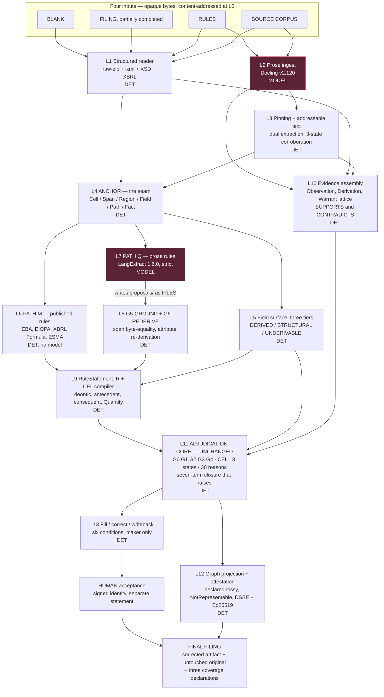

<!-- ARCHITECTURE DECISION — "ANCHOR". 18 Aug 2026.

     METHOD. Five parallel research investigations (LangExtract 1.6.0, Docling 2.120.3 /
     docling-graph 1.9.1, the fintech filing-format landscape, the neuro-symbolic bar, and a
     file-level constraint map of this repo) -> three independent architectures -> nine adversarial
     critiques, three per architecture (a compliance lead, a staff engineer, and a guardian of the
     coverage-declaration thesis) -> this synthesis. 18 agents, 0 errors.

     RE-VERIFIED BY HAND after the run, each against the code named:

       * cel_path() emits an ABSTRACT dotted path (n_3_portfolio.r7.co), NOT "Sheet!Ref".
         docs/audit/ASSESS-vision-gap.md Gap 3 is half wrong; facts/build.py has no cel_path at all.
       * The "Sheet!REF" anchor string: 69 construction-site lines across 29 modules in src/
         (this document says 77/30 with a wider regex; the earlier "six" was six SUBSYSTEMS).
       * The model ban lives in tests/negative/importgraph.py:57 (BANNED_IN_VERDICT). The string
         "cdfc.model" appears ZERO times in tests/contract/test_contract_verdict_path.py.
       * severity.py: BLOCKING needs n>=189 clean filings, BLOCKING_MIN_NON_SYNTHETIC=30 and
         person_a_kind=="human". fixtures/corpus_manifest.json records n=40, n_non_synthetic=0,
         person_a_kind='n/a — no blind fill exists (D-P8-01)'. AUTO-FILL IS GATED ON A COMMERCIAL
         NEGOTIATION, NOT A SPRINT.
       * campaign_store.observable(fault_class) takes NO predicate and returns the CLASS-WIDE O.
       * The campaign seeded 112 DISTINCT SITES against a 3,747-cell field surface.
       * MEASURED HERE, and it is the most consequential number in this document:
             106 of 348 candidates read at least one seeded cell.
             242 of 348 were NEVER given a fault on any cell they read.
         Of the 106 exercised, 33 killed. So "348 of 348 rejected at G2" is not the honest
         statement it is presented as: at most 106 rejections are evidence about a CHECK, and 242
         are evidence about a SAMPLE. (242 is an upper bound: 46 candidates bind validation ranges
         rather than explicit cells and are excluded from the intersection.)

     ONE CLAIM IN THE PRIOR DRAFT WAS WRONG AND IS CORRECTED HERE: the G2 ancestry defect is a
     FALSE POSITIVE (ancestry_state() publishes "VERIFIED" for a claim never checked), not a
     silent fail-open, and the "anchor on the candidate's own envelope" fix is TAUTOLOGICAL. -->

# cdfc — Architecture Decision: **ANCHOR**

> **SUPERSEDED IN PART — read `docs/PLAN.md` for the current plan.** This is a dated decision record
> (18 Aug 2026) and it is deliberately NOT edited to match later results. Five things in it have
> since been measured and changed: the §9 Phase-4 segmenter is a re-extraction problem rather than a
> parsing one and no longer costs 6–10 weeks; §4.3's flagship net-worth example is checkable against
> the source corpus but NOT against the filing; §5.5(b)'s adjudicator campaign now has real data;
> the §9 phases are numbered `A0`–`A5` to stop colliding with the build phases `P0`–`P15`; and a
> field-correspondence component (`A1c`) has been added that no phase here contained. Line 500's
> note that `invalid.denominator_disagreement` is *raised by no code* was true when written and is
> false now — probe `A1-5` observes it firing.

*A format-neutral front end and a two-path rule ingress onto an adjudicator that does not change.*

Written 18 Aug 2026. Grounded in `docs/audit/ASSESS-vision-gap.md`, the three candidate architectures and their nine critiques, and measurements I re-ran in this session against `/Users/abishaikc/Gift`. Where a critique and the research brief disagreed, I ran the code; four such disagreements are corrected below and each correction changes the plan.

---

## 1. The answer in one page

**Build a format-neutral front end onto the existing adjudicator, and do not rewrite the adjudicator.**

The audit's Gap 3 says the fact-key vocabulary is `"Sheet!Ref"` and does not survive contact with PDF or XBRL. That is half wrong, and the half that is wrong is worth a quarter of engineering. `cel_path(sheet, ref)` returns `n_8_compliance_status.r6.cc` — a lawful CEL identifier chain with no `!` and no sheet syntax (`src/cdfc/predicates/harvest.py:120`). I ran it. The `"Sheet!REF"` string survives only as a **leaf value** (`__cell__`) inside the fact tree and as the key type of six subsystems. So the predicate language, the AST walker, the static key extraction, `FactView`, G0, G1, G3-proof and G4 are already document-agnostic. What is spreadsheet-shaped is one *string type* and one *gate* (G2's observability filter).

So: **substitute one opaque `Anchor` type for that string, add one CEL root, add two new gates, and leave everything else.** All 571 committed envelopes keep their JCS digests, because envelope identity is computed over `schema_keys` and `schema_keys` are already abstract paths.

On top of that seam, two rule ingress paths that both terminate in one `RuleStatement` type:

* **Path M — the regulator published the rules as data.** A deterministic, model-free compiler per publisher format: EBA/EIOPA validation-rule workbooks, XBRL Formula assertions, the ESMA AIFMD rev-6 guidance spreadsheet, XBRL US DQC. **This is the only path that makes the predicate library non-empty this year, and it contains no LLM anywhere.**
* **Path Q — the rules are prose.** A model proposes; two new deterministic gates adjudicate: **G5-GROUND** (the span exists byte-for-byte in the pinned instrument) and **G6-REDERIVE** (every scalar attribute is independently re-derived from the grounded span by our own parser, or the statement is rejected).

The evidence graph is **a projection of the run, not the substrate of it** — emitted through the existing `attest/projections/` pattern with its mandatory self-naming lossy flag and its `NotRepresentable` exception. This is the single largest cost saving available and it is stolen wholesale from a critique: rewriting the store to hold *one* denominator differently is the most expensive way to change nothing a buyer can see.

### What LangExtract does in it

One job, on the propose side only: **turn a provision of statutory prose into candidate spans with character offsets.** It runs behind the import-closure ban, in a separately-resolved lockfile, and it never touches the verdict path. Its ~80 KB pure-Python aligner (`resolver.WordAligner` + `core/tokenizer` + `core/data`, Apache-2.0, zero model dependencies) is **vendored into the verdict path** so G5 can re-run alignment offline. Its own `alignment_status` is never our grounding test.

### What Docling does in it

One job: **PDF / DOCX / HTML prose → text with stable character offsets and page/bbox provenance**, for the RULES corpus and the SOURCE corpus. It is **never** the ingress for a workbook (`docling/backend/msexcel_backend.py:332,336` open with `data_only=True`, discarding the formulas from which all 571 envelopes are induced), **never** a writer (there is no xlsx/docx/pdf serializer in `docling_core/transforms/serializer/`), and **not yet** a field-surface source for DOCX (see §2).

### The honest sentence about Docling Graph

> **docling-graph is real, first-class and well-built — docling-project/docling-graph, MIT, v1.9.1 (2026-07-17), maintained by the Docling core team at IBM Research — and it does not solve our central problem. Its graph is an *instance graph of extracted entities*: nodes come from Pydantic model fields, edges from typed field relationships. There is no primitive anywhere in it for deontic force, an antecedent/consequent pair, a deadline, a threshold with units, or a cross-reference with a resolvable target. Its own legal example models an obligation as a node with a name. Adopting it would give a perfect extractor a better place to put a *citation*, not a place to put a *conditional*. Gap 2 survives it untouched.** We take two of its *ideas* — the four-tier provenance ladder with an explicit `unresolved` state, and a merge that never auto-fuses ambiguous entities — and none of its code.

### What changes about cdfc

1. `CellKey = "Sheet!REF"` becomes an opaque `Anchor` with a canonical string rendering. **77 construction sites across 30 modules in `src/`** (I counted; the "six sites" in the brief is six *subsystems*).
2. `run_filing` gains a `template` parameter; the three `lru_cache`d FME globals get keyed; `invalid.denominator_disagreement` finally fires.
3. `BOUND_ROOTS` goes from `{filing, template}` to `{filing, template, evidence, rule}`. Additive — no envelope digest moves.
4. `Obligation`-as-citation is replaced by `RuleStatement` (LegalRuleML-shaped names, no XML toolchain) with `Quantity{value, unit, tolerance}`. **This is the one-way door.** Do it once, with the full target vocabulary.
5. Two new gates, G5 and G6, and a new gate-outcome value `G2_INAPPLICABLE`.
6. Two real bug fixes that are prerequisites, not improvements (§5).
7. The report gains two more coverage declarations (rules, instrument units), each with its own `assert_closed` that raises.
8. A signed human **`Disposition`** record, so the coverage declaration can be *closed* rather than left as 1,849 signed admissions on a return the customer filed anyway.

### What is not achievable as the owner stated it

> *"where evidence and confidence suffice it should FILL or CORRECT the filling. The professional intervenes only on genuine ambiguity."*

Not next year, and the blocker is not engineering. A fill is only safe if a qualified check can test it afterwards. `qualify/severity.py` requires, for `BLOCKING`: Wilson upper bound ≤ 0.02 (needs ~189 clean filings with zero fires) **and** `n_non_synthetic ≥ 30` **and** `person_a_kind == "human"`. `fixtures/corpus_manifest.json` records `n: 40, n_non_synthetic: 0`. Thirty real filings-plus-source-packs is a **commercial negotiation with a client's general counsel**, not a sprint. And the fields where a professional's hours actually go — strategy classification, instrument taxonomy, PAI coverage, related-party allocation — have no admittable predicate and never will, because they are judgement.

**The nearest achievable thing, and it is better business: ship CHALLENGE before FILL.** A `CONTRADICTS` edge does not claim the filing is wrong. It claims two documents the customer already owns disagree — a mechanically verifiable fact about the documents. It needs no admitted library, no calibration set, no autoformalisation, and no clean corpus. A false contradiction costs a reviewer five minutes; a wrong auto-filled number goes into a return somebody signs, and there is no AI defence to a preparer penalty.

---

## 2. What LangExtract and Docling actually give us

### 2.1 LangExtract

`google/langextract`, Apache-2.0, **v1.6.0** released 2026-07-02, `requires-python >= 3.10`. Explicitly *"not an officially supported Google product"* (README.md:534-541). Sources: <https://github.com/google/langextract/blob/main/pyproject.toml>, <https://api.github.com/repos/google/langextract>.

| | |
|---|---|
| **Solves** | Prompt-driven extraction of typed spans from prose, with character offsets, over long documents (sentence-aware chunking, `max_char_buffer` default 1000, `extraction_passes` for recall). **A runtime-built output schema**: `lx.schema.extraction_item_schema()` / `extractions_schema()` (`core/output_schema.py:191-290`) let us derive the extraction target set from the blank's own induced field surface, so nothing is hand-authored per return. A **pure, model-free, importable aligner** (`resolver.WordAligner.align_extractions`) that loads without any model SDK. A free pre-flight validator that checks the few-shot examples are themselves alignable (`prompt_validation.py`). |
| **Does NOT solve** | **Grounding, in the sense a reader assumes.** At default settings a fabricated *"within 90 days of the end of each quarter"* returns `MATCH_FUZZY` at a span reading *"within 30 days"* — 8 of 9 tokens match against a `_FUZZY_ALIGNMENT_MIN_THRESHOLD = 0.75` LCS (`resolver.py:57`). `MATCH_LESSER` grounds the same string onto the six characters *"within"* (`resolver.py:1006-1020`). **And the `attributes` dict — which is where the deontic force, the threshold, the unit, the deadline and the target eId live — carries no offsets at all** (`core/data.py:88`); a measured run produced an extraction whose span read *"within 45 days"* carrying `attributes {'value': '90'}`. There is **no confidence signal**: every provider hardcodes `ScoredOutput(score=1.0)`. There is **no response cache**. There is **no PDF/Word/OOXML input** — text only. There is **no first-party Anthropic provider**; routing is by regex on `model_id` in `providers/patterns.py`. There is **no published precision or recall figure for any domain**. |
| **We build** | (a) Our own ~150-line Claude provider implementing `get_schema_class()`, because `output_schema` is honoured only by the Gemini and OpenAI providers (`core/base_model.py:69-113`) and the runtime-derived schema is the whole reason to adopt this. (b) **G5-GROUND**: the admission predicate is `alignment_status == MATCH_EXACT` under `resolver_params={'enable_fuzzy_alignment': False, 'accept_match_lesser': False}` **AND** `pinned_text[start:end].casefold() == quote.casefold()` **AND** the span does not intersect a `DISPUTED` region. (c) **G6-REDERIVE**, §5. (d) Dedup keyed on `(extraction_class, char_interval)` — chunking re-proposes the same obligation once per chunk with no dedup. (e) Chunk-level checkpointing and our own backoff. (f) Pre-segmentation by provision, so we bypass `ChunkIterator` entirely. (g) `document_id` set explicitly — it defaults to a fresh `uuid4` and the JSONL is otherwise non-reproducible. |

**Mandatory call-site configuration, pinned and treated as attested configuration:** `resolver_params={'enable_fuzzy_alignment': False, 'accept_match_lesser': False}`, `prompt_validation_level=ERROR`, `prompt_validation_strict=True`, `fetch_urls=False`, `document_id` explicit, exact version pin. Alignment defaults have already changed inside the 1.x line; a minor bump can silently move every attested offset.

**UNCONFIRMED — do not build on these:**
- `langextract-anthropic` 0.2.1 and `langextract-claude` 0.1.0 exist on PyPI, are **not** in Google's `COMMUNITY_PROVIDERS.md`, and **were not audited**. Whether either implements `get_schema_class()` is unknown. Write our own provider.
- `MATCH_GREATER` is defined in the enum and **assigned nowhere** in 1.6.0. Do not branch on it; do not write an exhaustive match over the enum.
- Whether controlled generation raises the verbatim-substring rate is **unmeasured by anyone**.

**Dependency posture.** A full install is **56 packages / 190 MB**, with `google-genai` and `google-cloud-storage` as hard dependencies regardless of backend. It goes in a **second, separately-resolved lockfile** used only by the propose side; the fresh-clone `make verify` must not install it. The ~80 KB aligner is vendored, separately, for the verdict path.

### 2.2 Docling

`docling-project/docling` v2.120.x and `docling-core` schema **v1.10.0**, MIT. Sources: <https://docling-project.github.io/docling/usage/supported_formats/>, <https://raw.githubusercontent.com/docling-project/docling-core/main/docling_core/types/doc/common/reference.py>.

| | |
|---|---|
| **Solves** | PDF/DOCX/HTML/XBRL-XML → `DoclingDocument` with per-element provenance: `ProvenanceItem` is exactly `page_no` + `bbox` + `charspan`, and `CharSpan` is 0-indexed — directly reconcilable with our pinned instrument's offsets. Table structure with cell-level geometry, `row_span`/`col_span`, `column_header`. Chunkers whose `DocMeta.doc_items` carry whole `DocItem` objects, so a chunk an LLM read traces back to page and span without a separate index. An XBRL backend (via Arelle) that turns numeric facts into a key/value graph. And a **fillable-form vocabulary** — `FieldValueItem.kind ∈ {read_only, fillable}`, `DocItemLabel.EMPTY_VALUE`, `TableCell.fillable` — which is IBM independently arriving at *absent ≠ empty ≠ zero*. |
| **Does NOT solve** | **The workbook.** `msexcel_backend.py:332,336` both call `load_workbook(data_only=True)`; the only occurrence of "formula" in its 1,898 lines reads chart series range strings. XLSX provenance is degenerate: `charspan=(0,0)` on every item, bounding boxes that are row/column indices, `column_header` hardcoded to `row == 0`. **Writeback.** No serializer exists for xlsx, docx or pdf — `markdown_excel.py` is a markdown flavour. **PDF forms.** Nothing in the standard PDF pipeline populates `key_value_items` or `field_items`; a detected FORM region becomes a bare `GroupItem` with text children. Key→value structure from a PDF form requires the 258M-parameter granite-docling VLM DocTags path — i.e. it is a model proposal. **Table accuracy is materially worse than the headline**: docling-eval's own measurement is mean TEDS **0.81** on PubTabNet struct-only, with **23.2% of tables at or below 0.80** — roughly one table in twelve materially wrong, *and the tool cannot say which*. |
| **We build** | Every writer. The tabular-evidence locator triple (§4). The three-tier field-surface classifier (§6). Our own dual-extraction wrapper — `qualify/textsource.build()` already takes `Extraction` objects and does not know what produced them (`instruments.py:26` names it as the drop-in point), and it *requires* ≥2 extractions and a declared blindness mechanism for every absence, which is exactly the discipline a Docling-sourced corpus needs. |

**UNCONFIRMED — this one kills a milestone:**
- **The DOCX backend populates no `FieldItem`, `FieldValue` or `FieldRegion`.** The only callers of `add_field_item` / `add_field_key` / `add_field_value` / `add_field_region` are in `html_backend.py` (`:3755, :3773, :3816, :4364`). Any plan that says "ingest the IFSCA Compliance Report `.docx` blank through Docling to get a field surface" is **dead on arrival**. A `.docx` blank's fillable slots are *declared OOXML structure* — `w:sdt` content controls, `w:fldChar` FORMTEXT, empty table cells — and belong in our own raw-zip + lxml reader, as a DECLARED-tier surface with no model at all.
- Whether `FieldValueItem.kind='fillable'` is recoverable from any real PDF form: **not confirmed on any shipped PDF or VLM path.** Needs a spike against a blank/filled pair before anything leans on it.
- Multi-page table fidelity: representable, visibly less exercised (`_clamp_provenance_bboxes_to_pages` bails when a table spans pages). No benchmark. Unverified either way.
- docling-graph's *"byte-identical output for the same inputs"* is a documentation claim about `merge`. **It was not executed.** Do not put it in an attestation.

### 2.3 Two corrections to the brief, measured this session

**(a) The pinned instrument's spans are DOCUMENT-GLOBAL, not page-local.** A critique built a three-coordinate-system finding on the assumption they are page-local. They are not. `corpus/instruments/statute-fm-regulations-2025.text.json` carries `text` as a single 197,767-character normalised string; `units[0].span == [0, 189]`, `units[-1].span[1] == 197767 == len(text)`, spans monotone and contiguous. `text[21994:22206]` is exactly unit `p0148.s0008`. The `page` field is metadata. **G5's coordinate reconciliation is therefore trivial**, and this is a material de-risking of the whole prose path.

**(b) There is still no eId.** Unit keys are `p0148.s0008` — page-ordinal, sentence-ordinal. There is no chapter, regulation, sub-regulation or clause anywhere in the pinned text source. So `REFERS_TO` targets and per-provision chunking need a **deterministic provision segmenter**, with its own typed-skip contract and its own published placement rate. That is a Phase-4 prerequisite, not a subtask.

---

## 3. The architecture

| Layer | Responsibility | Technology | Det/Model |
|---|---|---|---|
| **L0 Ingress & receipt** | Four inputs as opaque bytes → content-addressed `Artifact` with a declared `media_type` and `role ∈ {BLANK, RULES, SOURCE, FILING}`. Never fetch. Never normalise before hashing. | Existing `ingest/receipt` + `ingest/container_guard` — **wired to a caller for the first time**; it currently has none. Media-type dispatch. | **DET** |
| **L1 Structured reader** | Container bytes → typed parts for formats whose structure is *declared*: OOXML `.xlsx`/`.docx`, XML-against-XSD, xBRL-XML, xBRL-CSV report packages, CSV. | Existing raw-`zipfile`/lxml reader, **kept and extended**. Arelle for XBRL, pinned, propose-side only. **Never Docling for `.xlsx`.** | **DET** |
| **L2 Prose ingest** | PDF / DOCX-as-prose / HTML / scans → text, layout, tables, page+bbox+charspan provenance. The only place OCR/layout/VLM inference runs. | Docling v2.120.x + docling-core v1.10.0. | **MODEL** |
| **L3 Pinning & addressable text** | Any document → authoritative normalised text with stable global offsets, one corroboration state per unit. Disputed regions excluded and occupied by a `U+FFFD` sentinel so an intersecting quote is refused *by name*. | Existing `qualify/textsource.py`, generalised past instruments. Three states `AGREED / SINGLE_PARTY / DISPUTED`, recorded normalisation list, refused-transformation list. | **DET** |
| **L4 The Anchor domain — THE SEAM** | One opaque, content-addressed reference type naming a location in *any* artifact. `CellAnchor(sheet, ref)` renders the identical `"Sheet!REF"` string so all 571 envelopes keep parsing. | Frozen tagged union: `CellAnchor \| SpanAnchor(doc_sha, unit_id, start, end) \| RegionAnchor(doc_sha, page, bbox) \| FieldAnchor(doc_sha, field_id) \| PathAnchor(doc_sha, xpath) \| FactAnchor(concept, entity, period, unit, dims)`. Identity = `canon.canonical_json` + sha256. | **DET** |
| **L5 Field surface — three tiers, one refuses** | Derive the denominator from the **BLANK**, never from the filled copy and never from a model. | **DERIVED**: OOXML induction (formulas, DV, protection mask, cross-sheet refs, numFmt, cfRule), XSD element set, taxonomy walk, xBRL-CSV columns, AcroForm dictionary, `w:sdt`/FORMTEXT. **STRUCTURAL**: a model-free geometric detector proposes; a model may only *subtract* or *label*. **UNDERIVABLE**: a flat scan — **no fraction is published at all**. | **DET** |
| **L6 Path M — published rules** | Compile already-formal rules into `RuleStatement` with no model in the path. | Per-publisher compilers: EBA/EIOPA validation-rule `.xlsx` + quarterly deactivation packages; XBRL Formula value/existence/consistency assertions + Assertion Severity 2.0; ESMA AIFMD rev-6 guidance workbook; XBRL US DQC/XULE; customer-supplied FCA RegData guides. Arelle wrapped, never trusted as the verdict. | **DET** |
| **L7 Path Q — prose rules** | Propose `RuleStatement` candidates and `EvidenceSpan`s. Writes files into `proposals/`. Returns nothing to any gate. | LangExtract 1.6.0 in mandatory strict mode + our Claude provider, per-provision, output_schema built at runtime from L5. | **MODEL** |
| **L8 G5-GROUND / G6-REDERIVE** | G5 adjudicates the **span**. G6 independently re-derives **every scalar attribute** from the grounded span bytes. | G5: vendored `WordAligner` + byte/casefold equality + disputed-region refusal. G6: our own number/unit grammar, date grammar, deontic-verb lexicon, comparator lexicon, controlled-vocabulary enum — **registered as host functions**, so each carries published test vectors and a mutation score or it cannot register. | **DET** |
| **L9 RuleStatement IR + CEL compiler** | Hold a rule rather than a citation; compile it to the admitted CEL subset, or refuse with a typed reason. | Python dataclasses mirroring OASIS LegalRuleML v1.0 *names* (Obligation/Permission/Prohibition/Right, Bearer, PrescriptiveStatement if/then, ConstitutiveStatement, LegalReference with a resolvable target, Context/Jurisdiction/Authority, Override over/under) — **the ontology, not the XML**. Severity strings from XBRL Assertion Severity 2.0, default ERROR. Catala's default-plus-ordered-exceptions: a non-total exception order is a REJECT. `Quantity{value:int, unit:UnitCode, tolerance}`. | **DET** |
| **L10 Evidence assembly** | `Observation` and `Derivation` nodes from the source corpus; corroboration by content identity across independent extractors; `SUPPORTS` and `CONTRADICTS` drawn to values. **Hold disagreement rather than resolving it.** | `textsource` corroboration generalised; the existing `Warrant` lattice `DETERMINISTIC > MODEL_EXTRACTED > DERIVED` composed by `min`, raising on an empty read set, **promoted from a value attribute to the core attribute of every edge**. | **DET** |
| **L11 The adjudication core — UNCHANGED** | Decide. | CEL runtime + profile bans; G0/G1/G2/G3/G4; 8 `ItemState`s; `PRECEDENCE`; 30 reason codes; seven-term closure; DSSE+Ed25519. Three additive changes: a third and fourth `BOUND_ROOTS` member treated like `template` at `ast_walker.py:437`; `G2_INAPPLICABLE`; the two bug fixes in §5. | **DET** |
| **L12 Graph projection & attestation** | Emit the node/edge log **from** the completed run; Merkle-root it; sign plural subjects; re-derive and verify. | The existing `attest/projections/` pattern verbatim — mandatory self-naming lossy flag, `NotRepresentable`, joined to `make determinism`'s comparison set. Canonical-JSON JSONL, blake2b-16 node ids, no graph database, no new runtime dependency. | **DET** |
| **L13 Fill / correct / writeback** | Propose values; gate them; hand a human the review; write only accepted proposals. | One shared byte-preserving writer promoted out of `qualify/surgery.py` with two callers — the mutant seeder and the corrector. `.xlsx`/`.docx` raw-zip; PDF AcroForm/XFDF only; XML/xBRL-CSV emit the package. | **DET** |



---

## 4. The evidence graph, specified

The graph is a **total, deterministic fold over the completed run**: `project(run) -> Graph`, and `Graph.merkle_root` is a `MANIFEST_PINS` row and a `Subject`. You never have to trust it, because you re-derive it. Storage is frozen Python dataclasses plus two dict indexes in memory, serialised as canonical-JSON JSONL through the existing `src/cdfc/canon.py`. **No graph database.** SQLite may be a rebuilt read index carrying the Merkle root in a `meta` table so a stale index is detectable, and it is never an input to a verdict — a 500-row SQLite file built in reverse insert order is not byte-identical to one built forwards, and `VACUUM` does not rescue it. Kuzu is archived upstream. `networkx` may be imported on the propose side only.

### 4.1 Node types — eleven, closed

| Type | Identity | Fields |
|---|---|---|
| `Artifact` | sha256 of bytes | `media_type`, `role ∈ {BLANK,RULES,SOURCE,FILING}`, `receipt` |
| `Locator` | blake2b-16 over `(artifact_id, Anchor)` | the L4 `Anchor` variant; **corroboration lives on the artifact *region*, not on the pointer** |
| `Requirement` | blake2b-16 | `authority, jurisdiction, instrument_sha, return_id, period, cadence, deadline_basis, framework_version, validation_package_date` |
| `Section` | blake2b-16 | `parent`, `label_path` |
| `Field` | blake2b-16 over `(structural_fingerprint, stable_key)` — **not the artifact sha** | `dtype`, `value_kind ∈ {read_only,fillable}`, `surface_tier ∈ {DERIVED,STRUCTURAL}` |
| `RuleStatement` | blake2b-16 over declared identity fields | `deontic ∈ {OBLIGATION,PERMISSION,PROHIBITION,RIGHT,DEFINITION,EXEMPTION}`, `bearer`, `antecedent`, `consequent`, `quantity`, `temporal{status,from,to}`, `defeasibility`, `severity ∈ {ERROR,WARNING,OK}`, `scope`, `provenance ∈ {PUBLISHED,COMPILED_FROM_SPEC,INDUCED_FROM_ARTIFACT,PROSE_PROPOSED,OBSERVED_FROM_REJECTION}`, `grounding_state ∈ {GROUNDED,UNGROUNDED,ATTRIBUTE_UNVERIFIED}` |
| `Quantity` | blake2b-16 | `value:int, scale:int, unit:UnitCode, comparator, tolerance{value,unit}` |
| `Predicate` | **its existing JCS envelope digest — unchanged** | `admission_state`, `claims_fault_classes`, `severity` |
| `Observation` | blake2b-16 | `locator_id`, `raw`, `normalised`, `dtype`, `unit`, `warrant`, `extractor_id` |
| `Derivation` | blake2b-16 | `op` (from a closed set), `inputs:[node_id]`, `result`, `warrant = min(inputs)` |
| `Value` | blake2b-16, **frozen and append-only** | `field_id`, `payload`, `presence ∈ {ABSENT,EMPTY,PRESENT}`, `origin ∈ {FILED,PROPOSED,ACCEPTED}`, `supersedes` |
| `Finding` | blake2b-16 | `state:ItemState`, `reason:ReasonCode`, `scope_kind`, `support ∈ {SUPPORTED,UNSUPPORTED,CONTRADICTED,NOT_ASSESSED}`, `witness_locators`, `remedy` |
| `Gate` | blake2b-16 | `gate_id ∈ {G0..G6}`, `subject_node`, `outcome ∈ {ADMIT,REJECT,UNVERIFIABLE,INAPPLICABLE}`, `measurement` |
| `Disposition` | blake2b-16 | `finding_id`, `outcome ∈ {CHECKED_MANUALLY,ACCEPTED_IMMATERIAL,ESCALATED}`, `basis`, `reviewer_id`, `signed_at_seq` |

> **`Field` is keyed on the structural fingerprint, not on `sha256(blank bytes)`.** IFSCA reserves the right to modify formats between periods and publishes no version tag. A cosmetic re-save would otherwise produce new ids for all 3,747 fields and detach every accepted human decision and every period-over-period comparison at once. `src/cdfc/schema/fingerprint.py:69` already computes the right thing and today has **zero callers in `src/`**.

### 4.2 Edge types — fourteen, typed and directed

Every edge carries `{warrant, admitted_by: gate_node_id | null, produced_by: run_id}`. An edge is a **claim**; an unadmitted claim is drawn but not counted.

```
REQUIRES      Requirement -> Section | Field
CONTAINS      Section     -> Section | Field
AT            Field       -> Locator          (may be UNRESOLVED; blocks predicates, never guesses)
GOVERNS       RuleStatement -> Field | Section | Requirement
STATED_IN     RuleStatement -> Locator        (exists only if G0 and G5 admitted it)
REFERS_TO     RuleStatement -> RuleStatement  (resolvable target; if it does not resolve the edge is NOT created)
USES_DEFINITION RuleStatement -> RuleStatement
DEFEATS       RuleStatement -> RuleStatement  (Tarjan SCC must be trivial AND the order total, or the set is REJECTED)
COMPILES_TO   RuleStatement -> Predicate      (absent = a declared reason, never silence)
BINDS         Predicate   -> Field            (this is cells_bound; filing-rooted keys ONLY)
OBSERVED_AT   Observation -> Locator
INPUT_TO      Observation | Derivation | Value -> Derivation
SUPPORTS      Observation | Derivation -> Value
CONTRADICTS   Observation | Derivation -> Value        ← FIRST CLASS, from day one
PROPOSES      Derivation  -> Value
SUPERSEDES    Value       -> Value
ACCEPTED_BY   Value       -> Reviewer
ADJUDICATES   Finding     -> Field | RuleStatement | Value | TextUnit
QUALIFIES     Gate        -> Predicate | RuleStatement | Edge
DISCHARGES    Disposition -> Finding
```

`CONTRADICTS` is first class because the documented gap in W3C PROV-O is precisely that it cannot represent contradicting evidence, and because a graph that cannot hold two sources disagreeing will silently pick one — which is the failure this product exists to refuse.

### 4.3 Worked example — one real field, one real rule, one real gap

Every identifier below is **verified against bytes in this repository**. I read them this session.

**THE FIELD.** In the pinned FME blank `fixtures/prescribed/Reporting_Format_for_Fund_Management_Entities_02012026_20260102_0255.xlsx`, sheet `8. Compliance Status`, Table 8.1 "Compliance Details". Row 3 of that table:

- `B6` = *"The Net worth requirement has been complied with at all times during the reporting period."* (shared string 479)
- `C6` is the **answer cell**, under column header `C3` = "Compliance". An `x14:dataValidation type="list"` over `sqref C4:C9` binds it to `Dropdown!$H$3:$H$4` = **{Yes, No}**. The sheet carries `<sheetProtection algorithmName="SHA-512" …>`.
- The blank's own prompt in that row reads *"If No, please provide the details"*.

```
Artifact  a_blank  sha256(...)  role=BLANK  media_type=application/vnd.openxmlformats-…sheet
Locator   loc_C6   CellAnchor(sheet="8. Compliance Status", ref="C6")   renders "8. Compliance Status!C6"
Field     f_nw     stable_key = ("8. Compliance Status", "Table 8.1", "3 · The Net worth requirement…", ord=3)
                   dtype=ENUM  value_kind=fillable  surface_tier=DERIVED
          -- AT --> loc_C6                                        [RESOLVED]
Field     f_cat    "1. Introduction" C10="Category of Registration of FME", answer cell D10,
                   x14 DV list Dropdown!$J$3:$J$5
                   = {Registered FME (Retail), Registered FME (Non-Retail), Authorised FME}
          -- AT --> loc_D10   CellAnchor("1. Introduction","D10")
```

CEL paths, from the live `harvest.cel_path`: `filing.n_8_compliance_status.r6.cc` and `filing.n_1_introduction.r10.cd`; template vocabularies `template.vocab.n_8_compliance_status_c4` and `template.vocab.n_1_introduction_d10`.

**WHAT THE ENGINE CAN CHECK TODAY, AND WHY IT IS WORTHLESS AS ASSURANCE.** The harvest induces one predicate over `f_nw`: *the value is a member of the declared vocabulary.* It is real, it is in the 348, it binds one cell — and `"Yes"` is always in the vocabulary. The field is `PASS`, and `PASS` here means nothing about net worth.

**THE RULE.** From the pinned instrument `statute-fm-regulations-2025` (197,767 chars normalised; 1,218 units; **1,189 AGREED / 28 DISPUTED / 1 SINGLE_PARTY**; parties `pdfplumber 0.11.10` and `pypdfium2 5.13.0`; transformations `strip_soft_hyphen`, `nfkc`, `collapse_whitespace`; refused `unify_dashes`, `case_fold`, `unify_quotes`):

```
TextUnit  u_reg8    key=p0148.s0008  span=[21994, 22206]  corroboration=AGREED
  text: "(1) An entity seeking registration as a FME shall at all times comply with the
         net worth requirements as specified in Second Schedule of these regulations or
         such other amount as may be specified by the Authority"

TextUnit  u_sch2    key=p0188.s0012  span=[167740, 167780]  corroboration=AGREED
  text: "SECOND SCHEDULE NET WORTH REQUIREMENTS S"
  followed at [167780…] by: "No. Category Net Worth 1 Authorised FME USD 75,000
         2 Registered FME (Non-retail) USD 5,00,000 3 Registered FME (Retail) USD 1,000,000"

TextUnit  u_def_nw  key=p0144.s0015  span=[7389, 7882]   corroboration=AGREED
  text: regulation 2(w), "'net worth' means the aggregate value of the paid-up share
        capital … and all reserves created out of the profits, securities premium
        account and debit or credit balance of profit …"
```

```
RuleStatement r_nw8
  deontic     = OBLIGATION            ← G6 re-derived "shall" from bytes [21994,22206]
  bearer      = "an entity seeking registration as a FME"
  antecedent  = null                  ← unconditional at this level
  consequent  = COMPLY_WITH(ref = SECOND_SCHEDULE)
  temporal    = {status: IN_FORCE, from: 2025-02-10}
  defeasibility = DEFEASIBLE          ← "or such other amount as may be specified by the Authority"
  severity    = ERROR                 ← default, per XBRL Assertion Severity 2.0
  provenance  = PROSE_PROPOSED
  grounding_state = GROUNDED
  -- STATED_IN --> loc(u_reg8)        [ADMITTED by G5: text[21994:22206].casefold() == quote.casefold()]
  -- REFERS_TO --> r_sch2             [target RESOLVED to p0188.s0012 — edge created]
  -- USES_DEFINITION --> r_def_nw     [target RESOLVED to p0144.s0015]
  -- GOVERNS  --> f_nw
  -- GOVERNS  --> f_cat               (the antecedent selector)

RuleStatement r_sch2   deontic=DEFINITION  provenance=PROSE_PROPOSED
  table: three (category, Quantity) pairs
    Quantity q_auth      {value: 75_000,    scale: 0, unit: USD, comparator: GTE}
    Quantity q_nonretail {value: 500_000,   scale: 0, unit: USD, comparator: GTE}
    Quantity q_retail    {value: 1_000_000, scale: 0, unit: USD, comparator: GTE}
```

> **`USD 5,00,000` is the live G6 test case.** Indian lakh digit grouping. A model that emits `{value: 5, unit: USD_MILLION}` or `{value: 5}` is caught by the re-deriver reading the span bytes; a re-deriver whose grammar does not know lakh grouping **refuses** and the attribute is recorded `ATTRIBUTE_UNVERIFIED`, which blocks compilation and lands the field on `no_predicate.rule_ambiguous`. It does not guess.

**THE COMPILATION.** `r_nw8 ∘ r_sch2` compiles to a conditional predicate the current `Obligation` vocabulary structurally cannot express, and which needs the new `evidence.` root:

```cel
filing.n_1_introduction.r10.cd.v == "Registered FME (Non-Retail)"
  ? evidence.fin_stmt.net_worth.v >= rule.reg8.threshold.v
  : true
```

`BOUND_ROOTS` today refuses this — I ran `check_subset` and an unbound third root is rejected with *"a predicate binds exactly two names"*. Under ANCHOR it compiles, and `bound_cells` counts **only** the `filing.` root, so `evidence.` and `rule.` contribute **zero** to the denominator. That rule is the difference between a coverage number and a lie, and it is the ninth chance to repeat the count-vs-contents defect this repo has already caught eight times.

**THE EVIDENCE — and this is the whole point of the architecture.** The net worth figure **is not in the workbook.** The return asks the filer to *assert* compliance with a dropdown. The number lives in the audited financial statements or a net worth certificate — a PDF in the source corpus.

```
Artifact    a_fs       role=SOURCE  media_type=application/pdf   "FY2026 audited financials"
Locator     loc_nw_v   RegionAnchor(doc_sha=a_fs, page=14, bbox=[318,442,392,456])
Locator     loc_nw_r   RegionAnchor(doc_sha=a_fs, page=14, bbox=[ 72,442,236,456])   row label "Net worth"
Locator     loc_nw_c   RegionAnchor(doc_sha=a_fs, page=14, bbox=[300,398,400,412])   col header "As at 31 Mar 2026"
Observation o_nw       raw="612,480"  normalised=612480  dtype=MONEY  unit=USD
                       warrant=MODEL_EXTRACTED  extractor_id=docling@2.120.3
            -- OBSERVED_AT --> loc_nw_v
            triple_locator = (loc_nw_v, loc_nw_r, loc_nw_c)   ← REQUIRED, see below
Observation o_nw2      identical normalised value from a second independent extractor
                       -> corroboration on the region = AGREED

Value       v_c6       field=f_nw  payload="Yes"  presence=PRESENT  origin=FILED
Derivation  d_test     op=GTE  inputs=[o_nw, q_nonretail]  result=true  warrant=MODEL_EXTRACTED
            -- SUPPORTS --> v_c6
Finding     fi_c6      state=PASS  support=SUPPORTED
                       witness_locators=[loc_C6, loc(u_reg8), loc(u_sch2), loc_nw_v]
            -- ADJUDICATES --> f_nw
            -- VIA --> predicate(r_nw8)
```

**The tabular-evidence triple is mandatory and it is the answer to the failure mode that actually produces fines.** A span adjudicator proves *where a string is*. It cannot prove *what the string means* — a number's bytes carry no concept. `612,480` grounds perfectly whether it is net worth or total reserves. So a tabular `Observation` must carry an adjudicated `(value span, row-label span, column-header span)` triple plus a **deterministic geometric constraint** that the value's bbox lies at the intersection of its row and column bands, re-derived from pinned page geometry with no model in the loop. Where the geometry is not recoverable — scanned, rotated, multi-page — the observation is `PROPOSED_UNADJUDICATED` and **may not support a fill or a contradiction**. Given docling-eval's own **23.2% of tables at or below 0.80 TEDS**, this is not caution; it is the only thing standing between "we show you provenance" (commoditised, free, table stakes) and "the number is the number you think it is".

**The failure case, which is the demo.** If the audited financials say `USD 384,000` and the filer ticked `"Yes"`, then `d_test.result = false`, the edge is `CONTRADICTS`, and:

```
Finding fi_c6  state=FAIL  support=CONTRADICTED
               remedy="Second Schedule requires USD 500,000 for Registered FME (Non-Retail);
                       the audited financials at p.14 report USD 384,000"
```

That finding needs **no admitted predicate library, no calibration set, no G4 corpus** — it is a claim about two documents the customer already owns. It is what we ship first.

**The honest refusal, which is equally the demo.** If the source corpus contains no net worth figure at all, the field lands `NOT_RUN(not_run.external_source_lacks_field)` — **only if** the evidence-side instrument coverage shows the artifacts were actually read to a pre-registered threshold. If they were not, it lands `NOT_RUN(not_run.budget_exhausted)`. Those are different findings with different remedies and the system is not permitted to choose the flattering one (§5).

---

## 5. Where the model line falls, and how it is enforced

### 5.1 What a model may propose — exhaustively

1. The boundaries of an `EvidenceSpan` / the extent of a `Locator`.
2. Every field of a `RuleStatement`.
3. A candidate `GOVERNS` mapping from a rule to fields.
4. A candidate `SUPPORTS` / `CONTRADICTS` binding from evidence to a value.
5. A candidate `Value` with `origin=PROPOSED`.
6. Prose rationale for humans, in an unhashed sidecar.
7. On the `STRUCTURAL` field-surface tier: a *label* or a *subtraction* — **never an addition.**

### 5.2 What a model may NEVER produce

An `ItemState`. A `ReasonCode`. A denominator, or any member of one. A settled fraction. A kill rate. A gate outcome. An admission decision. A `Value` with `origin=ACCEPTED`. A number that appears in any coverage declaration. A sentence a user reads about a verdict.

### 5.3 The six mechanical enforcements

**E1 — Import-closure ban, widened.** `tests/negative/importgraph.py` already defines `BANNED_IN_VERDICT` over seven `VERDICT_ROOTS` (`cdfc.evaluate, cdfc.verdict, cdfc.probes, cdfc.selfcheck, cdfc.attest, cdfc.qualify, cdfc.surface`) and already bans `cdfc.model` **as a package** — its own comment says an enumeration is a list somebody has to remember to extend and *"this project has been bitten by exactly that shape four times."* Add `langextract`, `docling`, `docling_core`, `docling_graph`, `litellm`, `torch`, `transformers`. Add `cdfc.graph` and `cdfc.compile` as roots. Enforced under EXACT-SET semantics by `tests/negative/test_nc_model_free.py::test_nc__A04a_no_model_import_reachable`, with the companion assertion that every closure exceeds 25 modules so an empty walk cannot pass as a clean one.

**Cite that walker, not `tests/contract/test_contract_verdict_path.py`.** I checked: the string `cdfc.model` appears **zero times** in that file; it bans vendor SDKs over three roots and it skips relative imports entirely (`if node.level: continue`, line 44). The brief cites the wrong file, and a reviewer who checks will find it.

**E2 — The seam is a file, and CI forces it to be.** Because `cdfc.qualify` is itself a banned-*from* root, a gate structurally **cannot** import a proposer. That is why G0/G1/G3/G4 are already provenance-blind — `g2_kill.check(cand, …)` never learns who authored `cand`. The proposer writes `proposals/<id>/extractions.jsonl` (the LangExtract `AnnotatedDocument`, pinned and hashed) plus `proposals/<id>/statements/*.yaml`. The bundle sha256 becomes a `MANIFEST_PINS` row. Gates read directories. This shape already ships: 571 harvested envelope YAMLs whose header reads *"GENERATED by `cdfc harvest`. Do not hand-edit."* Extend `ci/barrier5.sh` — registry row 124, LIVE, observed red 16 Aug 2026 — under the same RETAIN-decision rule to cover `src/cdfc/model/` as a package, plus an AST check that its only write target is `proposals/`.

**E3 — Grounding is byte equality, never "it came with a span."** See §2.1. `MATCH_FUZZY` and `MATCH_LESSER` are UNGROUNDED, full stop.

**E4 — Attribute-level re-derivation, and it is the defensible original claim.** Grounding grounds the **quote**; it does not ground the **rule**. Every scalar attribute of a proposed `RuleStatement` must be independently reproduced from the grounded span by a deterministic parser in the verdict path. Mismatch → `not_run.extractor_disagreement`. Unparseable → `no_predicate.rule_ambiguous`. **The re-deriver's lexicons are registered as host functions**, because `HostFnRegistry.register()` refuses a function with no published test vectors, no mutation score and no named author, and `freeze()` closes the set before evaluation. That is not an extra burden — it is the *only* way this project is allowed to admit a new check, and a deontic-verb lexicon is exactly what `matches()` is banned for (the obvious registration-number regex fires on **87 of 228** live FMEs). I searched the prior art specifically for attribute re-derivation and did not find it: AWS Bedrock Automated Reasoning checks (GA 6 Aug 2025) stop at ensemble agreement over translations and state plainly that the translate step *"may contain errors"*. Nobody re-derives the translated value from the source span.

**E5 — The machine is the MAKER and cannot be the CHECKER.** `Value` is frozen and append-only; there is no `PROPOSED → ACCEPTED` transition, only a new node plus an `ACCEPTED_BY` edge naming a human. An AST check asserts no module under `cdfc.fill` can construct `origin=ACCEPTED`. A negative control attempts it programmatically and must raise. Examiners distinguish procedural four-eyes from **systemic** four-eyes and only the second satisfies them.

**E6 — The narration ban.** Every user-visible sentence about a verdict is generated from the `Finding` record by a template function in `cdfc.surface`, which is a verdict root and therefore cannot import the model. New negative control **NC-A01**, written before the proposer: inject a proposer returning a *correct* rule alongside an *incorrect* natural-language verdict; the report must render the gate's verdict and the injected string must be absent from every output byte. This is the measured failure mode — *scope laundering*, the LLM reporting conclusions its own solver did not produce, persisting across all five models tested in arXiv 2606.16118.

**And one thing the proposer must never see.** `sites.site_universe()` takes no predicate parameter and its import closure provably does not reach `cdfc.predicates`, because v0 sampled mutation sites from the predicates' own read set and scored **100.0% on 3,574 mutants** — the degenerate-baseline failure committed by the harness built to detect it. Extend that import walk to also forbid reach into the proposer, **and to the fill path**: nothing in the fill proposer may read the admitted predicate set, or fill condition (5) is satisfied by construction and carries zero information.

### 5.4 Two prerequisite bug fixes, both verified this session

**(i) G2's anti-gaming check reports `VERIFIED` for a claim it never checked.** The brief says `_claim_commit` returns `""` and the check fails open silently. **It does not.** I ran it: `docs/FAULT-CLAIMS.md` is committed at `be58634a` (12 Aug 2026), so `_claim_commit` returns a real commit for *every* candidate; `merge-base --is-ancestor` succeeds because P4 predates every campaign; and `ancestry_state()` (`g2_kill.py:277-279`) returns the literal string **`"VERIFIED"`**, which the funnel publishes. That is not a hole, it is a false positive on a published artifact — the twelfth instance of a check defeated by its own prose.

And the fix both the brief and one architecture propose — anchor on the candidate's own envelope file — **is tautological**: a proposer necessarily commits its envelope before the campaign that scores it, so the check can never fail. The real property is *"the claim was fixed before the site set was known."* Commit order cannot express that. The fix is: commit the campaign's `probe_seed` and derived site set independently of and unreadable by the proposer, bind the proposal-bundle digest to that seed, and record an unresolvable anchor as `UNVERIFIABLE`. That is a `campaign_store` change plus a negative control, not a one-function change.

**(ii) `observable()` has no predicate parameter, so 315 of the 348 `no_kill` rejections are a sampling artifact.** `campaign_store.py:131`: `def observable(self, fault_class) -> int` returns the campaign-wide `O` for that class. So `g2_kill`'s `UnexercisedClaimError` guard can only fire when the campaign observed zero mutants of a class **anywhere**, never when it observed zero *on the cells this candidate reads*. The campaign manifest records its sampling rule: **72 of 4,252 field-surface cells**, stratified, ≤12 per stratum, plus 40 formula cells — **112 sites**, and `kill_rate: 189/739`. A predicate covering one cell (P-0002 covers `1. Introduction!D3`) is scored `0/68` against a class-wide denominator and rejected with the remedy *"either the claim is wrong or the check is"* — a false dichotomy whose true third branch is *"no fault was ever seeded where this predicate could see one."*

**Consequence: "348 of 348 rejected" is not the honest statement it is presented as.** The honest statement is closer to *"33 candidates were exercised; the other 315 were never given an observable fault on any cell they read, and their gate outcome is UNVERIFIABLE."* Fix `observable()` to intersect with the candidate's read set and give `O_candidate == 0` its own outcome. **This is the cheapest high-value experiment in the entire plan** and it must land before Path M is built on top of the gate, or Phase 2 publishes a table of zeros whose cause is a 72-of-4,252 sample.

### 5.5 **The hardest question: what replaces the kill gate for a rule proposed from prose?**

**Nothing does. There is no substitute, and pretending otherwise would be this project's twelfth self-defeating check.** Here is the honest decomposition.

The kill gate asks one question: *does this check, when a fault is seeded into the artifact under test, catch it?* For a prose-proposed rule that question **splits into three**, and only one of them G2 can still answer.

**(a) Is the compiled predicate discriminating? — G2 STILL ANSWERS THIS, UNCHANGED.** A predicate is a predicate. Seed the fault in the **filling**, hold the rules and the corpus fixed, and `observability.recalculate` propagates it through the filing's own `<f>` elements (F19). `U/G` is computable and the three-way filter holds. Provenance-blind by construction — the gate never learns a model proposed the rule. **Nothing weakens here.**

*Except on formula-free filling formats.* `observability.cone_for` is the transitive downstream cone of the edited cells. An AIFMD XML instance, an xBRL-CSV package and a `.docx` compliance report have no formula graph: the cone is the edited node alone, every mutant diffs trivially, `U = 0`, and `K/O` collapses to *"what fraction of the site universe does this predicate read."* That is exactly the two-way form `observability.py:12-24` was written to forbid, *"in the direction that flatters us."* **So we add a fourth gate outcome, `G2_INAPPLICABLE`, and forbid quoting a kill rate for formula-free artifacts.** The declaration says: *on this artifact class the kill gate cannot discriminate, and here is how many predicates were admitted without it.* Where an artifact class has a genuine dependency structure — XBRL's calculation linkbase — it supplies the propagation oracle and G2 applies. That is a strong argument for making **XBRL, not AIFMD-XML, the first non-Excel filling target.**

**(b) Is the translation faithful? — G2 CANNOT ANSWER THIS, AND THE SUBSTITUTE IS AN ADJUDICATOR KILL CAMPAIGN.** The fault here is not in the filing; it is in the rule. But this one is *easier* than G2, not harder, because **we generate both the corruption and the ground truth and there is no observability problem at all.** Take N grounded spans, corrupt the attribute (`90 → 30`, `DAY → MONTH`, `shall → may`, `USD 5,00,000 → USD 500,000,000`, correct-quote-wrong-concept table bindings), and measure the **false-admit rate of G5 and G6**. That number — *"our adjudicator admitted k of n fabricated proposals"* — is publishable, pre-registerable, and is the number a buyer should be handed. `ci/barrier6.sh` refuses any adjudicator without one, on the same two-directional shape `barrier5.sh` already gets right.

**(c) Did the extractor MISS a rule? — NOTHING ANSWERS THIS, AND WE SAY SO.** There is no seeded-fault instrument for recall, because the population of rules a statute contains is not enumerable. Two weaker but honest guarantees replace it:

1. **Planted-obligation recall.** Insert K known rules into a copy of the instrument text; measure how many the proposer recovers. This is a real, pre-registered number and it bounds recall *on planted rules only*. Say that. It does not bound recall on rules nobody planted.
2. **Instrument coverage over a denominator two independent parsers agreed on.** Every one of the 1,218 pinned units lands in exactly one of `YIELDED_RULE / READ_NO_RULE / NOT_READ / DISPUTED_REGION`. This converts an *unbounded* miss into an *enumerable* one. **Critically, `READ_NO_RULE` is only a positive statement if it is measured** — an agent can emit 1,218 null extractions and every one replays perfectly. So `READ_NO_RULE` is admissible only where planted-obligation recall was measured on that instrument, and it carries the measured recall on its face.

**The sentence to publish, unhedged:** *"For a rule we compiled from prose, we can show you the exact bytes it came from, we can show you that every number and every unit in it was independently re-parsed from those bytes and not taken from the model, we can show you that the compiled check catches a seeded fault in the filing, and we can show you which of the 1,218 units of the instrument yielded nothing. We cannot show you that no rule was missed, and no one can."*

---

## 6. Coverage and validation semantics, rewritten

### 6.1 The vocabularies do not change

**8 `ItemState`s. No ninth.** `PRECEDENCE` is a 7-member total order consumed by `worst()` via `min(states, key=rank)`, `rank()` raises on `NO_PREDICATE`, `REMOVAL_BASIS` keys on `(state, reason)` with the default *"count, never remove"*, and `BUCKET_OF` must be total. A ninth state moves four coupled invariants for a distinction `Value.origin` already carries. Keeping fill outside `ItemState` makes *"a cell that was CORRECTED must never roll up as a cell that PASSED"* **structurally impossible rather than a discipline someone maintains.**

**30 reason codes. No thirty-first.** `REASON_COUNT: Final[int] = 30`, pinned in four documents. And here is the evidence the vocabulary was designed for this workload before this workload existed: I grepped, and these have **exactly one occurrence in `src/`** — their own definition:

| Code | Fires when | Remedy |
|---|---|---|
| `not_run.external_source_lacks_field` | the corpus was read to the pre-registered threshold and the fact is not in it | supply the missing document |
| `not_run.external_source_unavailable` | the artifact could not be opened | supply a readable copy |
| `not_run.extractor_disagreement` | **G6 refusal** — the re-derived attribute contradicts the proposed one | fix the extraction; the span is named |
| `indeterminate.extraction_abstained` | `SINGLE_PARTY` corroboration, or a `PROPOSED_UNADJUDICATED` triple | a second independent extraction |
| `indeterminate.conflicting_sources` | a `Value` carries both `SUPPORTS` and `CONTRADICTS` | resolve the source precedence, or decide |
| `no_predicate.requires_judgment` | the rule compiles to nothing decidable | a professional decides; the rule text is shown |
| `no_predicate.rule_ambiguous` | a `DEFEATS` order that is not total; an unresolvable `REFERS_TO`; an attribute G6 could not parse | named, per case |
| `no_predicate.rule_withdrawn` / `not_run.deactivated` | **the regulator deactivated the rule** | re-run against the current validation package |

The last pair is the EBA's own quarterly vocabulary. It ships packages that *deactivate, reactivate and re-grade the severity* of published validation rules and reminds authorities not to validate against deactivated ones. **A regulator institutionalised two of our dead codes.**

**One honest caveat on the C3 test.** `no_predicate.rule_ambiguous` is being asked to carry three conditions with three different remedies. Audit the remedy strings before claiming zero-new-codes as a win; if the remedies genuinely differ, the C3 admission test says two of them earn codes. Do the exercise; do not assume the answer.

### 6.2 The owner's four new states, placed

| The owner said | Where it goes | Why |
|---|---|---|
| **unsupported by evidence** | `Finding.support ∈ {SUPPORTED, UNSUPPORTED, CONTRADICTED, NOT_ASSESSED}` — a **field**, not a code | Its field-level remedy is *"produce the evidence"*, which does not differ from an existing code's remedy. Arbitration **C3** is the in-house precedent: it refused `out_of_scope.precondition_degenerate` because a field on an existing code (`ScopeKind`) carried the same distinction without moving any count. |
| **conflicting sources** | `indeterminate.conflicting_sources` — **exists, never fired** | Exact match, including the remedy. |
| **requires derivation** | **Not a coverage state at all** — `FillDisposition ∈ {DIRECT, REQUIRES_DERIVATION, REQUIRES_JUDGMENT, NO_EVIDENCE, CONFLICTING}` on the fill side | A field that requires derivation may be *perfectly checked* and simply not auto-fillable. Putting it in the coverage vocabulary would conflate "we could not check it" with "we could not fill it". Those are different tables. |
| **requires human judgement** | `no_predicate.requires_judgment` on the coverage side; `REQUIRES_JUDGMENT` on the fill side | Exists, never fired. |

### 6.3 Three declarations, three closures — and each one raises

`assert_closed` is what makes field coverage a *declaration* rather than a table of counts. Publishing a second and third number backed by nothing but a report is exactly the asymmetry this product exists to condemn. So each gets its own totality function, its own pinned constant, and its own exact-set test.

**(1) FIELD COVERAGE — unchanged in form.** Seven terms — `outOfScope, informational, settled, indeterminate, notRun, noPredicate, error` — summing to the field surface, or `assert_closed` raises and **there is no degraded report**. Today: settled **1,898 of 3,747**; unchecked **1,849**, split **422 gate-refused / 1,427 no-candidate**; denominator declaring its own exclusions (**6,757** cells recorded → **505** formula + **2,505** locked excluded → **3,747**). `settled` splits into `settledDeterministic` / `settledModelEvidenced` — not an eighth term, using the in-house precedent of `closure.py`'s existing sub-counts, which carry a distinction without moving the sum.

**(2) RULE COVERAGE — new. `RULE_TERM_COUNT: Final[int] = 6`.** `EXECUTED / COMPILED_NOT_ADMITTED / NOT_COMPILABLE / NOT_BOUND / DEACTIVATED_BY_PUBLISHER / PROPOSED_REFUTED`, each with a remedy. **The denominator must be externally enumerable.** On Path M it is: the regulator publishes the rule count against `(framework_version, validation_package_date)`. **On Path Q there is no such number, and we publish no fraction** — only the instrument-coverage table plus proposed-rule counts as a bare numerator. A rule-coverage percentage whose denominator is "what the model proposed" measures the adjudicator's agreement with the proposer and nothing else. It is the numerator choosing its denominator, arriving at the gate built to catch it.

**(3) INSTRUMENT COVERAGE — new. `INSTRUMENT_TERM_COUNT: Final[int] = 4`.** `YIELDED_RULE / READ_NO_RULE / NOT_READ / DISPUTED_REGION`, summing to the pinned unit count. On the pinned IFSCA instrument: **1,218 units, 1,189 AGREED, 28 DISPUTED, 1 SINGLE_PARTY** — the denominator declaring its own exclusions exactly as the field denominator does. This is the analogue of Bedrock's fidelity report, with a remedy per uncovered unit instead of a score, and a lawyer can audit it line by line.

### 6.4 The rule that protects all three: the denominator declares its own provenance

**No denominator may be derived from a model's output. A model may subtract from a denominator or label its members; it may never add to one, and it may never change one after publication.**

Mechanically:

```python
Denominator.provenance ∈ {RULE_DIFFERENTIAL, SCHEMA_DECLARED, STRUCTURAL_DETECTED, EXTRACTOR_AGREEMENT}
Denominator.gate_discrimination ∈ {MEASURED, INAPPLICABLE}
```

Both are inside the attestation payload, both render on the face of every fraction, and the render rule is copied verbatim from `qualify/corpus/provenance.py`, which already forbids a number where the warrant is absent: **a fraction over an `EXTRACTOR_AGREEMENT` denominator renders as `"— unwarranted (EXTRACTOR-AGREEMENT)"`, never as a percentage** — for the same reason a SELF-AUTHORED corpus is forbidden a number: *printing 0.0% is worse than printing nothing, because it has the shape of evidence.*

This is what makes the `UNDERIVABLE` tier real rather than aspirational. **On a flat scan we publish the field set and refuse the ratio.** A buyer will experience that as a regression. Losing those workflows is cheaper than a fraction over an invented denominator.

A taint that would resize the field surface fires `invalid.denominator_disagreement` — declared at `invalid.py:26`, raised by no code and asserted by no test today.

### 6.5 Two more things the declaration needs to be usable

**Severity must reach the state.** L6 ingests Assertion Severity 2.0 (`ERROR`/`WARNING`/`OK`, defaulting to ERROR) and today nothing maps a WARNING onto an `ItemState`. A failing non-blocking rule is not a FAIL to a preparer — they file and they explain. If the report shows it as FAIL, a team learns within two quarters to ignore FAILs, and the one signal that matters is destroyed. `Evaluation.severity` is a field; the report partitions failures by it. No code moves.

**The declaration must be closeable — and this is the change that decides adoption.** Today the artifact says: *at the moment of filing, we knew 1,849 fields were unverified.* Signed, timestamped, contemporaneous. Then the customer signs the return anyway, because the deadline is statutory. In an enforcement action or a s.166 review that document is Exhibit A, and counsel will tell them not to generate it.

So: a **`Disposition`** record — signed, outside `ItemState`, exactly the pattern already chosen for fill. Each unchecked field can be discharged: *checked manually by [named person], [date], [basis]*, or *accepted as immaterial*, or *escalated*. The declaration then publishes **three** numbers: checked by machine / discharged by human / open. A run whose third number is zero is a document a firm hands an examiner as a **defence**. A run whose third number is 1,849 is a confession. Same honesty, opposite legal posture, and the mechanism costs nothing we have not already built.

A `CONTRADICTS` finding with no `DISCHARGES` edge is the worst possible artifact to hold — documented knowledge of a discrepancy with no documented resolution. `Disposition` closes that too.

---

## 7. Fill and correct

### 7.1 The admission rule — six conditions, all required, all machine-checked

**(1) FIELD UNAMBIGUOUS.** Exactly one `Field`; `AT` edge RESOLVED; dtype and unit known from the blank's own induction. An `UNRESOLVED` key blocks and never guesses — under a naive `(sheet, label-above, label-left)` key, **1,749 of 1,953** candidate cells collide.

**(2) EVERY INPUT GROUNDED.** Every `Observation` consumed passed G5 (`MATCH_EXACT` under strict resolver params **and** byte/casefold equality against the pinned text). Tabular observations carry an adjudicated `(value, row-label, column-header)` triple with the geometric intersection satisfied. A span intersecting a `DISPUTED` region is refused outright.

**(3) WARRANT FLOOR.** `compose_warrant` over the whole read set returns `DETERMINISTIC` or `MODEL_EXTRACTED`. `EmptyReadSetError` already refuses to hand the strongest warrant to a value derived from nothing. A `DERIVED`-only chain is refused. The lattice already prevents laundering: a sum of three deterministic reads and one model-extracted value is `MODEL_EXTRACTED`, not `DETERMINISTIC`.

**(4) NO CONTRADICTION.** Zero `CONTRADICTS` edges into the target value → otherwise `indeterminate.conflicting_sources` and no fill. **The system never picks.** A tool that resolves two disagreeing sources has replaced a professional's judgement with a coin toss and hidden it.

> *But contradiction is the normal state of a close.* Draft NAV vs final NAV, unaudited vs audited, a custodian file that has not settled a late trade. So the customer supplies a **declared, pinned, deterministic source precedence** — `asOf`, issuer authority, explicit `SUPERSEDES` edges — as configuration inside the manifest. Then "final supersedes draft" is a re-derivable fact rather than a permanent refusal. Without this the fill path is unusable in season, and that is a design defect, not a virtue.

**(5) RULE COMPLIANCE — and the quantifier is inverted.** The set of `RuleStatement`s with a `GOVERNS` edge to the field must be **non-empty**, and every member must have a G4-admitted `Predicate` that PASSES on the proposed value. An empty universal is true, so the naive form authorises a fill with **zero rules consulted** — which, with the library at 0 rows, would be every fill.
  * **Zero governing statements** → its own published class, *"filled on evidence alone, no rule known"*, never auto-accepted.
  * **A governing predicate rejected at G2** → a hard block carrying `no_predicate.failed_qualification`. It compiled, so it is not "no predicate"; it is not admitted; it must not fall through both clauses. That is the modal case today (315 `no_kill` + 33 `no_margin`).

**(6) THE ROUND TRIP.** Write into a scratch copy by byte-preserving surgery, re-run the deterministic checker, and require: the target field moves to PASS; **no other field-surface state moves ADVERSELY** (PASS→FAIL, settled→unsettled); every field moving FAIL→PASS was named in the fill's declared consequent set *before* the write; **and every recomputed formula-cell VALUE that changed was named too.**

> The naive form — *"no other cell's state moves at all"* — is broken twice over. It rejects every correct fill into a workbook that sums, because the total's predicate correctly moves FAIL→PASS. And the cells a fill actually propagates into are the **505 formula cells**, which are excluded from the field surface and have no `ItemState` at all, so the guard passes trivially on exactly the propagation that matters. A fill that puts a number in the wrong sub-line and silently changes a reported total satisfies the naive guard.

**Performance note.** This guard is serial and is `O(fills) × O(full run)`: 400 fills × ~6 s = **~40 minutes**. The fix is already in the repo and off-path: the precedent map (**1,462 nodes / 4,115 transitive edges**) gives the forward closure of the edited cell, so re-evaluate only the predicates whose read set intersects it. `O(full run)` becomes `O(cone)` and the guard drops to seconds. This is the cheapest large win in the plan and it finally puts the precedent map on the production path.

### 7.2 Confidence — two stages, and only the first ships

**Stage 1: ensemble agreement at unanimity.** N ≥ 3 independent proposals from pinned, distinct model ids at temperature 0 where exposed; admissible iff all N produce the byte-identical value after the deterministic normaliser. This is the design AWS shipped and defended in a GA product, and it needs **no labelled data**, which is why it is first. Threshold **1.0**, not AWS's tunable 0.5–0.9: a fraction below unanimity means the models disagreed about a number going into a regulatory filing. The agreement ratio is computed **once** at proposal time, stored as an exact integer ratio in the pinned proposal bundle, and never recomputed at run time — otherwise it drags a network call into the verdict path and destroys both byte identity and the import-closure guarantee.

**Stage 2: split-conformal abstention** (arXiv 2405.01563) gives a genuine finite-sample bound on the error rate of what we do fill, and it fits the project's pre-registration discipline exactly. **It requires a labelled calibration set of known-correct fillings. That is a named human blocker of the same species as the 50 proviso spans, and I am naming it now rather than discovering it later.** Until it exists the product states: *we do not publish a bounded error rate on filled fields.*

### 7.3 Where to point fill, and it is the opposite of the obvious answer

`docs/audit/ASSESS-fill-correct-harness.md:140` measures it: **2,244 of 3,747** field-surface cells carry a value constraint — vocabulary, numeric/integer/date bound, or requiredness. The other **1,503** are *"where a filler's judgement actually lives — names, addresses, free text."*

The naive reading is "fill the 2,244." That is backwards. A dtype-and-range constraint is a test **any plausible wrong number passes**. Meanwhile the identifier and classification fields — LEI, ISIN, registration number, jurisdiction, counterparty name, category of registration — are where the hours go **and** are exactly checkable, because the fill is a *copy from a pinned source string* and the check is byte equality against a grounded span.

**So: fill identifiers by grounded copy first; fill derived numerics last, and only behind an admitted predicate.**

### 7.4 Writeback, per format

| Format | What we write | Refusal |
|---|---|---|
| `.xlsx`, `.docx` | Raw-zip surgery: every entry copied byte-for-byte with original compression parameters, exactly the parts the edits name, `MultiPartEditError` otherwise. Measured basis: this preserves the 3.55 MB data-model part and all 19 x14 data validations; an openpyxl round-trip loses **24 parts** and every x14 validation. | **A cell the blank declares a formula for is never written.** `surgery.py:166` comments that overriding a formula cell strips its `<f>` — *"that IS the F11 fault"*, the flagship class the product detects. If a field is formula-derived we do not write it; we name the wrong input. |
| PDF with AcroForm | Field values, or an XFDF overlay. | Never a content-stream edit. |
| Flat PDF | **Nothing.** | A keyed correction schedule (Anchor → value) plus a review overlay, and we say so on the face of it. Rendering text into a flat PDF at a bounding box is forging a document. |
| XML / xBRL-CSV | Emit the instance or the report package. | — |

Docling contributes **nothing** here and it must be said out loud, because *"we're adding Docling"* will otherwise be read as *"writeback is handled."* Every write emits **two artifacts** — the corrected filing and the untouched original — both hashed into the attestation subject list, with a diff record `(Anchor, before, after, proposal_id, read_set, agreement_ratio)`. **The byte-diff must be produced by something that is not the writer**; independent verification of a writer's output is not optional in a regulated pipeline.

### 7.5 The human, and the audit trail

Proposals land as `Value{origin=PROPOSED}`. **There is no code path to `ACCEPTED` that does not consume a signed acceptance record carrying a human identity** (E5).

The review screen shows, per proposal, **sorted by weakest warrant first** so attention goes where the evidence is thinnest: the field; the proposed value; the prior value if any; every supporting span rendered in situ **coloured by our adjudication outcome and never by an extractor's own `alignment_status`** (which would paint `MATCH_FUZZY` hallucinations green); every contradicting span, *shown rather than resolved*; the governing rule's quoted text at its verified span with its two-party corroboration; the warrant; the agreement ratio; and — where relevant — the named rule that could not be checked. **There is no bulk accept.** One button accepts one row.

**Two things the research forced in, and they are not optional:**

- **Dwell time and per-proposal evidence-view events go into the signed acceptance statement, and proposals per acceptance action are capped.** Otherwise on day 19 of a 21-day IFSCA window an analyst clicks through 400 proposals in forty minutes, and the signed record *documents rubber-stamping* — which is worse for the customer than no record at all. If review time is in the signed record, then either the review was real or the record proves it was not, and the firm learns before the examiner does.
- **The acceptance statement attests the EVENT, never the PROPERTY.** *"Identity X accepted proposal P at seq N"*, subjects = proposal digest ⊕ identity — never *"this field is correct."* And `BANNED_EXACT` in `tests/contract/schema_walk.py` must gain `accepted, approved, verified, correct, signed_off` **before** the acceptance statement is designed. It currently blocks `result, status, pass, passed, passing, compliant, conformant, ok, success, clean` — and a signed acceptance is otherwise free to carry a cryptographically attested all-clear through a name the walker was never told about, inside the artifact whose credibility rests on being structurally unable to say pass.

**A rejected suggestion is data, not a discard.** Rejecting writes a `HUMAN_REJECT` record with an optional basis, the field returns to the unchecked population with its reason, and the rejection is a first-class row in the audit file. And the `PROPOSED`-and-not-accepted population is itself discoverable — a list of *"things a system told us were probably right and we filed differently anyway"* — so its retention policy and privilege posture needs an answer before the first fill, not after.

---

## 8. What we keep, change, and discard

| File / subsystem | Verdict | Why |
|---|---|---|
| `src/cdfc/verdict/reasons.py` — 30 codes, `REASON_COUNT=30` | **KEEP verbatim** | 8 of the 30 have never fired and are exactly what this workload needs. Two are the EBA's own vocabulary. |
| `src/cdfc/verdict/states.py` — 8 states, `PRECEDENCE`, `REMOVAL_BASIS`, `in_scope()` | **KEEP verbatim** | No ninth state. `in_scope()` remains the only removal decision. |
| `src/cdfc/verdict/closure.py` — 7 terms, `assert_closed`, no degraded report | **KEEP + 2 SIBLINGS** | Add `assert_closed_rules` (6 terms) and `assert_closed_instrument` (4 terms), each with a pinned count and an exact-set test. |
| `src/cdfc/predicates/cel_profile.py` — every ban | **KEEP verbatim** | Each has a measured reason. `matches()` — the obvious registration regex fires on 87 of 228 live FMEs. Floats — a tolerance nobody declared. `type()`/`dyn()` — they defeat the static key extraction that makes the settled fraction derivable rather than estimated. **And above all no clock.** A deadline is `filing.submission_date - filing.period_end <= rule.reg51.deadline_days`, which I confirmed is ADMITTED today as integer arithmetic. |
| `cel_profile.BOUND_ROOTS` | **CHANGE — 8 sites** | `{filing, template}` → `{filing, template, evidence, rule}`. Additive; **zero of 571 envelope digests move**. `ast_walker.py:437` must treat the new roots like `template` so they contribute zero cells. |
| `src/cdfc/qualify/g0_scope.py`, `g1_binds.py`, `g3_degeneracy.py` (proof arm), `g4_ffr.py` | **KEEP unchanged** | Already format-agnostic: `InstrumentText` + `find(quote)`; `(schema, facts, runtime)`; CEL-AST → Z3 with a deterministic `RLIMIT` and no wall clock; an import-closure computation. |
| `src/cdfc/qualify/g2_kill.py` | **CHANGE — 2 fixes, both prerequisites** | (a) `ancestry_state()` publishes `VERIFIED` for a claim never checked → bind to a pre-registered site-set seed. (b) `campaign_store.observable()` must intersect with the candidate's read set; `O_candidate == 0` gets its own outcome. Add `G2_INAPPLICABLE`. |
| `src/cdfc/qualify/observability.py` — three-way filter | **KEEP for structured fillings; DECLARE INAPPLICABLE otherwise** | Its own docstring records why two-way is wrong *"in the direction that flatters us."* |
| `src/cdfc/qualify/sites.py` — predicate-blind site universe | **KEEP; widen the import walk** | v0 sampled sites from the predicates' read set and scored 100.0% on 3,574 mutants. Extend the ban to the proposer **and the fill path**. |
| `src/cdfc/qualify/textsource.py` — dual extraction, 3 states, `U+FFFD` sentinel | **KEEP; GENERALISE** | The strongest format-neutral engineering in the repo. **But it *raises* on an unexplained absence, and two LLM extractors of a NAV pack cannot declare a blindness mechanism for a key they never emitted** — so it needs a segmentation-agreement step in front of it. Budget it; do not call it reuse. |
| `src/cdfc/qualify/surgery.py` | **CHANGE — promote** | One shared byte-preserving writer, two callers: the mutant seeder and the corrector. |
| `src/cdfc/predicates/host_fns/` — registry contract | **KEEP; REUSE** | No test vectors, no mutation score, no author → no registration; `freeze()` closes the set before evaluation. **G6's lexicons register here.** |
| `src/cdfc/evaluate/contract.py` — `Warrant` lattice | **CHANGE — promote and wire** | `compose_warrant` appears nowhere in `src/cdfc/surface/` and nowhere in the run output. It is currently **dead**. It becomes the core attribute of every edge and it must reach the report. |
| `src/cdfc/schema/stable_keys.py` | **CHANGE — wire it** | Exists with `RESOLVED/UNRESOLVED` refusal semantics; `rollup.RunCell.stable_key` today holds `"Sheet!REF"` strings. Make the field name true. |
| `src/cdfc/schema/fingerprint.py` | **CHANGE — call it** | Zero callers in `src/`. It becomes `Field` identity and the `handlers.py:94` fix. |
| `"Sheet!REF"` as a type — **77 sites, 30 modules** | **DISCARD as a type; KEEP as a rendering** | `CellAnchor` renders the identical string so all 571 envelopes keep parsing. **Note `qualify/template_instrument.py:105` uses it inside a hashed unit key** — the migration must be byte-identical there or nine committed `text_sha256` values move. |
| `src/cdfc/measure/p10_run.py:175` — `run_filing` with no template; 4 parameterless `lru_cache`d FME globals | **DISCARD** | The mechanism by which an ALR filing (own surface **1,599**) is scored over FME's **3,747** and reported VALID. |
| `src/cdfc/evaluate/run.py:127-140` — `run_id_for` | **CHANGE** | Must digest the full input closure: template, source corpus, rule set, `framework_version`, `validation_package_date`, proposal-bundle digest. Every published run id moves. **Take the pain now, at nine customers of zero.** |
| `src/cdfc/predicates/obligations.py` — `Obligation` as 8 citation fields; `Proviso` with no antecedent; `cross_reference` with no target; `Tolerance` as a dimensionless int in `MILLI_USD_MILLION` | **DISCARD — the one-way door** | Replaced by `RuleStatement` + `Quantity{value, unit, tolerance}`. **Do it once, with the full target vocabulary.** It invalidates all 571 envelope digests and their golden tests, and there is a window in which nothing reproduces against anything published. |
| `src/cdfc/probes/relations/` — six hand-authored relations | **DISCARD** | 0 of 6 pass any gate; 0 bindings on 8 of 8 non-FME templates; three builders are nullary functions returning constants while their docstrings claim to refuse workbooks they never read. |
| `src/cdfc/probes/precedents.py` — `PrecedentMap` | **KEEP the data, DISCARD the claim** | 1,462 nodes / 4,115 transitive edges is real and becomes the fill round-trip's cone. Its documented *"a cycle raises"* is measurably false — a 2-cycle converges silently. Replace `_close()` with Tarjan SCC that actually raises. |
| `src/cdfc/ingest/container_guard.py` | **CHANGE — wire it** | It has **no caller**. A 20 MiB appended entry trips `guard()`; `cdfc run` on the same file returns VALID. |
| `src/cdfc/api/handlers.py` — `"T1-T6 ran"`, `structuralFingerprint="sheet-shape:unknown"`, `f"sha-{name}"`, unconditional 422, 2-line `/v1/verify` | **DISCARD, Phase 0** | Every one is a false statement emitted to a user. |
| `src/cdfc/attest/dsse.py:103-124` — verifying against the envelope's own `publicKey` | **DISCARD** | A re-signed payload with an attacker key prints `reproduced YES / signature VALID`. Replace with a pinned key directory, plus rotation and a revocation story. |
| `src/cdfc/attest/verify.py:274-275` — feeding back `residue` and `counterEvidence` | **DISCARD** | They re-derive to themselves and cannot fail. `residue` is precisely the field a filer would want to zero. |
| `p5_run.py:39` — `registry_root = "root-p5-pre-gate-fixture"` | **DISCARD** | The real Merkle root sits unused at `predicates/registry.py:164`. A semantically-changed predicate currently yields a byte-identical, validly-signed attestation. |
| `src/cdfc/attest/statement.py`, `dsse.py`, `assert_not_production_key` | **KEEP** | Subjects are already plural and enforced `>= 2`. **But `verify.py:231` enumerates `("filing","template")` by name** — extending is a schema-and-verifier change, not a list append. Sequence it against published attestations. |
| `attest/projections/` — declared-lossy flag + `NotRepresentable` | **KEEP; REUSE VERBATIM** | This is how the graph ships. `NotRepresentable` becomes the honest record of exactly which parts of the graph vocabulary the engine cannot yet populate — a coverage declaration about the graph itself. |
| `tests/negative/` — 141 NC entries against 230 guards, EXACT-SET | **KEEP; EXTEND FIRST** | Every new closed vocabulary gets its NC catalogue **before** the code. |
| `requirements.lock` | **CHANGE — split** | A second, separately-resolved, hash-pinned propose-side lock. The fresh-clone `make verify` must not install it, or the 0-of-1,569,451 byte-identity result — obtained without torch — silently regresses. |
| `tests/unit/test_obligations.py:112` | **DISCARD** | It makes a false sentence a build requirement. |

---

## 9. The build, sequenced

Effort assumes a very small team. Where a critique argued an estimate was optimistic by 3–4×, I took the critique's number.

### Phase 0 — Truth, and one spike (3 weeks)

Delete every false statement in audit §5. Call `structural_fingerprint()`. Fix the two `--against` remedy strings. Unpin the false sentence at `test_obligations.py:112`. Correct `obligations.yaml:16`, `instruments.py:17`, `enumerate_shall.py`, `DECISION.md:27`, `proviso-labels.json`. Retire *"gate-qualified"* and *"mathematically attest"* until earned.

**And in week one, before anything else: open `2013-1358_aifmd_reporting_it_technical_guidance-revision6.zip` and the EBA validation-rules `.xlsx`.** One day. It decides whether Phase 2 is a parser or an extraction problem — i.e. whether Path M exists at all. It is the highest-value unknown in the entire brief and it is being carried inside the phase that depends on it.

**Becomes TRUE:** no surface emits a statement the code cannot support. **Demo:** nothing. That is the point. **Retires:** the risk that a buyer catches one falsehood in a bake-off and loses all the others.

### Phase 1 — The Anchor seam and the second template (8 weeks) — **SHIPPABLE**

The Anchor substitution across 77 sites / 30 modules, byte-identical rendering, `make determinism` producing 0 differing bytes before anything is built on top. `run_filing(filing, *, template)`; the three `lru_cache`s keyed on the template digest; `invalid.denominator_disagreement` fires. `run_id_for` digests the full input closure. Wire `post_filings` end to end — `receipt.receive → container_guard.guard → structural_fingerprint → bind_template → execute → 201 + runId` (the drop screen's success branch at `screens.py:150` is already written and unreachable). The G2 `observable()` fix and the ancestry fix. Widen `BANNED_IN_VERDICT`. Split the lockfile.

**The real workflow: an Excel blank published by an industry body with its rules in a separate PDF.** The named commercial target is the **ILPA Reporting Template v2.0** (released January 2025, replaces the 2016 template for funds in their investment period during Q1 2026, first delivery Q1 2027, distributed as Excel with a separate PDF Suggested Guidance document). It needs **no new reader**, the buyer is a GP finance team or fund administrator rather than a compliance function, and the 2026/2027 ramp means no incumbent has a mature rule library for it. The guaranteed fallback is the nine vendored IFSCA blanks.

**Becomes TRUE:** a buyer's own workbook is checkable without a code change, over its own denominator, through a browser. **Demo:** upload the ALR workbook and get ALR's own **1,599**-cell surface instead of today's VALID-over-FME's-**3,747**; then upload the ILPA template with three seeded defects and surface all three with exact witness cells. **Retires:** the single-template-by-construction risk, and the claim that the engine is not general (it is — proven with a 30-line script and no change to `src/`).

### Phase 2 — Path M, and the rule-coverage declaration (10 weeks)

The `RuleStatement` IR + `Quantity` + the CEL compiler. **This is the largest new trusted component in the plan and it is the one most likely to be under-budgeted** — LegalRuleML ships no engine, and by this project's own calibration P4 (envelope + CEL subset + AST walker + runtime + harvest) was four blocks. Then **one** deterministic compiler, chosen by the Phase-0 spike. Route compiled statements through the gates — **with the critical correction: Path M rules are `ADMITTED_BY_PUBLISHER` and always executed.** The kill campaign still runs and its output is a *published statistic* about the rule's discriminating power, never an admission veto. *"We declined to run your validation rule because it failed our internal qualification"* is a sentence no compliance officer can say to a supervisor.

**Becomes TRUE:** the product executes rules a regulator wrote, and publishes a rule-coverage table. **Demo:** *"of the N rules the regulator published at package date D, we executed M, and here is the typed reason and remedy for each of the other N−M — including the ones the regulator itself deactivated."* No incumbent publishes that second table, and it needs **zero LLM calls**. **Retires:** the "empty library forever" risk, and the autoformalisation risk entirely — the regulator wrote the rules down.

*Positioning correction from the critiques, and it decides whether Phase 2 sells:* where the denominator is externally fixed, a coverage table measures **our** incompleteness. Land Path M as an **overlay on the incumbent** — wrap Arelle, execute what we can, publish the declaration over the incumbent's run — not as a replacement. Nobody replaces a validator that executes 3,000 published rules with one that executes 40 and is candid about the other 2,960. Honesty about coverage is a differentiator **on top of** adequate coverage, never a substitute for it.

### Phase 3 — The evidence side: CONTRADICT, not FILL (10 weeks)

Docling ingress for the source corpus. Dual extraction with a segmentation-agreement step. The tabular `(value, row-label, column-header)` triple with the geometric constraint. The three-tier field surface with `Denominator.provenance` and the render refusal. `Observation` / `Derivation` / `SUPPORTS` / `CONTRADICTS`. The `Warrant` lattice wired into the report. The graph as a declared-lossy projection with a Merkle root in `MANIFEST_PINS` and `subject[]`.

**Becomes TRUE:** the product reads a folder of PDFs and says which filed values its own documents contradict. **Demo, on one real client's own quarter:** *"here are the 14 filed values your own documents contradict; here are the 260 nothing in your corpus supports; here is everything we could not check and why."* **Retires:** the "coverage is meaningless when facts come from PDFs" risk — because the answer is measured, published as a tier, and a fraction over a model-derived denominator refuses to render as a number.

### Phase 4 — Path Q (12+ weeks, and it has a hard prerequisite)

**Prerequisite, and it is not a subtask: the provision segmenter.** Deterministic, emitting a stable `eId` per provision over the document-global offset space, with its own typed-skip contract and a published placement rate against the 1,218 units. It unblocks per-provision chunking, `REFERS_TO` targets, and the whole rule denominator simultaneously. 6–10 weeks including the labelling to measure it.

Then: our Claude provider with `get_schema_class()`. LangExtract in strict mode, per provision. G5, G6, and their **adjudicator kill campaigns with published false-admit rates**. `ci/barrier6.sh`. Instrument coverage with planted-obligation recall. NC-A01.

**Becomes TRUE:** `predicates_with_a_STATUTE_obligation` is non-zero for the first time. **Demo:** the worked example of §4.3 — regulation 8(1) at `p0148.s0008`, its Second Schedule target at `p0188.s0012`, USD 5,00,000 re-derived by our own parser and not taken from the model, compiled into a predicate that fires on a filing — with the count of proposals refused at G5 and G6 published beside it.

### Phase 5 — Fill, gated on a negotiation, not a sprint

Everything in §7. **Do not start it until a named commercial owner has a route to 30 filing-plus-source-pack pairs from a real filer.** If there is no such route, `BLOCKING` is unreachable, "gate-qualified" carries a permanent asterisk for every regime, and the plan should say so in week one rather than discover it in month nine.

### The blockers that are people, not phases — name them now

| Blocker | Gates | Owner |
|---|---|---|
| **50 proviso span labels**, with a recorded labeller and seed | `g0_scope.py:131` raises `ProvisoRecallUnmeasured` on **any** STATUTE obligation. `fixtures/predicates/proviso-labels.json` has `labeller: null` and 0 spans. **No mechanical substitute exists.** Gates all of Phase 4. | Start by Phase 2. |
| **30 filing + source-pack pairs**, real, warranted correct | G4 `BLOCKING`. Gates all of Phase 5. `n_non_synthetic: 0` today. | Commercial. Start in Phase 1. |
| **A labelled calibration set** of known-correct fillings | The bounded error rate on fills. | After the corpus. |
| **The E6 RETAIN/DROP decision** | `ci/barrier5.sh`. `DECISION.md:3` reads PENDING. | **Do not weaken the barrier to make a demo.** |
| **Reproduction terms for the pinned instrument** | `docs/CORPUS-PROVENANCE.md:27` records them as **NOT ESTABLISHED FROM THE PUBLISHER**, and the report renders instrument spans in situ in a signed, self-contained HTML file handed to a customer. No layer owns this. | Legal, before Phase 3 ships to anyone. |
| **Retention, erasure, legal hold, key custody** | The log stores locators and digests, **not extracted content**, with content in a separately erasable store — decide this now; the alternative is incompatible with everything else. Plus HSM/KMS custody, rotation, revocation, and a commitment that a verifier which cannot replay a 2026 run says `UNREPLAYABLE_UNDER_THIS_VERIFIER`, never `INVALID`. | Before the first customer. |

---

## 10. What could make this fail

### Risk 1 — The denominator becomes a model's opinion, and the differentiator dies quietly

This is the existential one, and all nine critiques found a version of it independently. Today's denominator is derived from one artifact by static analysis and is therefore **not arguable**. The moment a field surface is extracted from a PDF, or a rule count is whatever a model proposed, the number retains its *shape* while its *warrant* changes — and the surface still prints it the old way. That is the count-vs-contents defect this repo has already caught eight times, applied to the one number the product sells.

**Mitigations in the design:** the three-tier surface with an `UNDERIVABLE` tier that publishes no fraction; the model may subtract from a denominator but never add to one; `Denominator.provenance` inside the attestation and on the face of every fraction; the render refusal copied from `CorpusProvenance`; rule coverage published only over an externally enumerable rule set.

**Cheapest killing experiment — 1 week.** Run the three-tier classifier over 20 real regulatory blanks: 5 PDFs, 5 DOCX, 5 XSD/taxonomy, 5 Excel. Measure the split. **If more than half land `UNDERIVABLE`, the non-Excel story is a refusal engine, and the honest strategy is to stay on structured formats and sell Path M.** That is a strategy, not a failure — but it must be known before Phase 3, not after.

### Risk 2 — The admitted library stays empty, so nothing is fillable and rule coverage reads zeros

`348 of 348` rejected at G2. `0` rows in the library. G4 never ran. If Phase 2's rule-coverage table reads *"N compiled, 0 executed, all COMPILED_NOT_ADMITTED"*, a buyer reads that as the product not working — regardless of how honest it is.

**Cheapest killing experiment — 1 day of code, 3.5 hours of compute, and it is the single highest-value experiment in this document.** Fix `campaign_store.observable()` to intersect with the candidate's read set, add the `O_candidate == 0` outcome, and re-run the existing 773-mutant campaign. It tells you whether *348 of 348* is a measurement or a 72-of-4,252 sampling artifact. Combined with the Phase-2 decision to admit Path M rules **by publisher**, this is what stands between a product and a research artifact. **Do it in Phase 0.**

### Risk 3 — The one-way vocabulary migration lands mid-flight

Extending `Obligation` → `RuleStatement` changes the envelope JCS digest, invalidating **571** committed envelopes, their golden tests, 141 NC entries against 230 guards under exact-set semantics, every published run id, and the byte-identity artifact set — with a window in which nothing reproduces against anything published. In a repo whose build standard is *one phase per session, every control observed red, fresh clone*, a half-landed migration is worse than no migration.

**Cheapest killing experiment — 2 weeks, before Phase 2 starts.** Do the migration on a branch **for a single harvest class**, with the full target vocabulary in place (deontic, bearer, antecedent, consequent, `Quantity{value,unit,tolerance}`, temporal window, applicability scope, severity, resolvable cross-reference target, definition source), and measure: how many golden tests move, how many NC entries move, whether `make determinism` returns to 0 differing bytes, and how long the red window is. If the answer is *"the red window is a month"*, the migration needs a compatibility shim and a two-digest transition, and that is a design decision to take before the branch, not during it.

### Cost per filing and latency

Measured on this machine, this session, except where marked as an estimate.

| | Measured / estimated |
|---|---|
| `cdfc run`, FME filing, 3,747 cells, 348 predicates | **5.5–6.0 s** wall; 1,945 evaluation rows; 343 KB `run.jsonl`; 672 KB `run.db` |
| `observability.grid_of` — full recalculation, 505 formulas / 4,798 literals | **0.047 s** |
| G2 campaign, 773 mutants, one workbook | **≈3.5 h** wall (~16 s/mutant), at **112 of 4,252** sites. *Fixing `observable()` implies a far larger site set: covering read sets properly is order 42,000 mutants, i.e. tens of hours per campaign, per template version, per predicate-set version.* **This is the largest unpriced cost in the plan.** |
| Fill round-trip guard, naive | 400 fills × 6 s = **~40 min** serial → **seconds** with the precedent-map cone |
| Path Q, per instrument version (estimate) | 197,767 chars over 1,218 units. ~400 provisions × 5–8 extraction classes × 3-model ensemble ≈ **1,200–1,800 calls**, **$200–320**, **~25 min** wall by the closest published analogue — which also reports total progress loss on a single 429. **Amortised across every filing of that regime.** Checkpointing is day-one work, not a note. |
| Path M, per rule-set version | Compute is trivial. **The cost is a data-ops subscription**: EBA ships deactivation packages ~10 Mar / 10 Jun / 10 Sep / 10 Dec — *ten to twenty days before quarter-end*, i.e. between a customer's draft run and their filed run. That is a person with an SLA, and a `validation_package_date` diff artifact, or the pin creates work rather than confidence. |
| Evidence pass, per filing (estimate) | 1,849 no-predicate fields; at 1–3 locate/extract calls each with a 3-model ensemble on bindings: **$250–1,000** and **1.5–3 h** at 20× concurrency on a cold first pass; **$30–60** on a warm re-run. Against an analyst-day, defensible. |
| Verdict path, per filing, after the rewrite | **Unchanged, single-digit seconds.** Dual extraction is a build-time artifact; the proposal bundle is pinned; no model and no network is reachable from the verdict closure. |

**The failure mode that matters is not cost, it is the deadline.** Every refusal in this system is unbounded and there is no degraded mode: `assert_closed` raises, `ProvisoRecallUnmeasured` raises, `StableKey.bind()` raises, `MultiPartEditError` raises. Each is correct engineering. Collectively, at 18:00 on a 21-day IFSCA clock, they are a tool that produces nothing and a team with no fallback — and a team that files without the tool twice never switches it back on. `closure.py`'s own docstring names the right answer for its own case: *narrow the field surface to the sheets where closure holds and publish the excluded sheets by name.* **Wire that branch everywhere. Every refusal must emit a machine-readable refusal artifact naming exactly what it excluded and why.** That is a declared exclusion, which is the thesis — not a fudge.

---

*One closing instruction, and it is the one I would defend hardest. Do not weaken `ci/barrier5.sh` to make a demo. It is the most defensible thing in the repository, and every architecture above is an argument for why it should hold.*