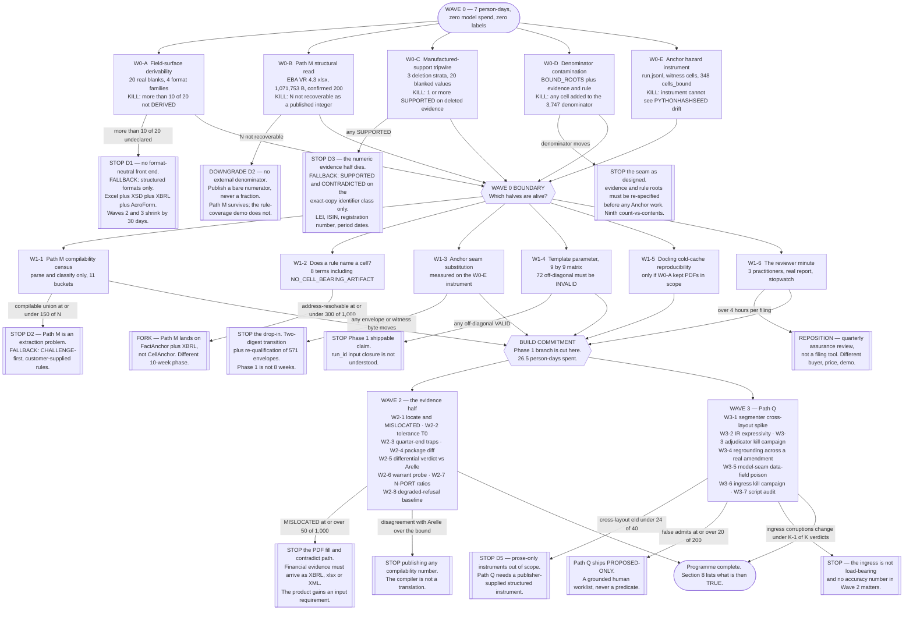

<!-- THE EXPERIMENT PROGRAMME. 18 Aug 2026.

     Written because the owner declined to commit to a large build without validating the approach:
     "I want to avoid shallow proxies or toy demonstrations. Every major component should be
     validated for its actual intended functionality, robustness, integration behavior, and failure
     modes before we commit to building the full system around it."

     METHOD. Five experiment clusters designed in parallel (documents, Path M, Path Q, evidence, the
     engine), each then handed to an adversary whose only mandate was to find the shallow proxy, the
     unreachable kill criterion and the missing experiment. Where an attack landed, the attack won.
     11 agents, 0 errors. Pre-registration idiom follows src/cdfc/experiment/prereg.py.

     RE-VERIFIED BY HAND after the run:

     * reports/qualification/qualification.json: 315 g2.no_kill + 33 g2.no_margin_over_baselines
       = 348 rejections, library 0 rows. ALL 315 no_kill carry kr_claimed = 0/N.
     * THE 33 THAT KILLED SOMETHING ARE EXACTLY THE 33 REJECTED FOR NO MARGIN OVER BASELINES
       (kill rates 3/68, 1/36, 4/387, 6/36, 20/68 ...). **So repairing observable() CANNOT PRODUCE
       AN ADMISSION.** It reclassifies rejections between no_kill and UNVERIFIABLE and nothing else.
       This corrects the earlier advice in docs/ARCHITECTURE-rules-and-evidence.md, which framed the
       repair as the experiment that would reveal whether the library could be non-empty. It cannot.
       It ships as a BUILD TASK for funnel honesty, not as an experiment with an upside.
     * The exercised/unexercised split is 106/242 counting only candidates with an explicit cell
       path, and 126/222 if validation-range predicates are resolved to their applied cells. BOTH
       reconcile with the committed ledger (242+73 = 315 and 222+93 = 315, where the second term is
       exercised-but-caught-nothing). The number depends on a modelling choice about DV-bound
       predicates and should be published as a range with its reason, not as one integer. -->

# The cdfc experiment programme

> **THE PRE-REGISTERED CRITERIA BELOW ARE NEVER EDITED.** Changing a criterion after seeing its
> result is the exact failure this document exists to prevent, so amendments live in
> `docs/PLAN.md §6`, which records for each experiment whether it was RUN, RECLASSIFIED, SUPERSEDED,
> NARROWED or DELETED, and why. In short: Wave 0 and `E1`/`E2`/`E3` have run
> (`docs/measurements/W0-results.md`); `W1-3` became build work; `W3-1` is superseded by a
> measurement that killed its baseline; `W2`'s similarity arms are dead by `W0-C`; and four
> experiments the graph spike created (`N1`–`N4`) are pre-registered in `PLAN.md §6`.

*Written 18 Aug 2026 against `/Users/abishaikc/Gift` @ `3f723fb`. Every number marked **MEASURED** was computed in this session by running the repo's own code; every URL was HTTP-probed in this session and its status, size and content-type are recorded. Where one of the five adversarial attacks landed, the attack wins: the experiment is cut, fixed, or replaced.*

---

## 1. The programme in one page

### What we are validating

Five one-way doors, and nothing else. Everything the architecture calls a "decision" that is *not* one of these five is a build task, not an experiment.

| # | The door | Wrong bet costs |
|---|---|---|
| **D1** | **Is there a denominator off Excel?** The coverage declaration is the only differentiator. It exists because a field surface is derived by static analysis from a blank's own bytes and is therefore not arguable. If the buyer's real blank set is PDF and prose, the front end is a refusal engine. | The whole non-Excel go-to-market, and every coverage number computed over a non-declared format is a lie the report signs. |
| **D2** | **Do regulators publish rules as compilable data?** Path M is the only route to a non-empty predicate library this year and it contains no model anywhere. | Phase 2, ten weeks, and the "zero LLM calls" claim in `ARCHITECTURE §1`. |
| **D3** | **Can an evidence pointer into a PDF be stored, and can support be manufactured?** `CONTRADICTS` is what we ship first. | Phase 3, ten weeks, and the demo sentence a buyer will test first. |
| **D4** | **Does the seam substitution preserve byte identity, and can a buyer's own workbook score over its own denominator?** | Phase 1, eight weeks, and every published run id. |
| **D5** | **Can prose become an admitted check safely?** | Phase 4, twelve-plus weeks, gated on human labelling that has not started. |

### The order, and the total

| Wave | What it decides | Person-days | Model spend |
|---|---|---|---|
| **Wave 0** — this week | D1 and D2 fork; two tripwires that can stop the numeric half and the denominator | **7** | **$0** |
| **Wave 1** — the build-commitment gate | D4 fully; D2's size; D3's environment; the buyer's minute | **19.5** | ~$50 |
| **Wave 2** — only if D1 and D3 survive Wave 0 | D3 fully; the tolerance every verdict hangs on; the external oracle | **23.5** | ~$450 |
| **Wave 3** — only if D2 and D4 survive Wave 1 | D5; the ingress kill campaign; the model seam | **14.5** | ~$190 |
| | **TOTAL before any commitment to build beyond Phase 1** | **64.5** | **≈ $690** |

**Build commitment is taken at the Wave-1 boundary, not at the end.** Wave 0 + Wave 1 = 26.5 person-days ≈ 3 calendar weeks for two people. That is what stands between today and cutting the Phase-1 branch.

### The single most likely reason this whole direction fails

**The denominator stops being derivable the moment the artifact is not a declared-structure file, so "auditable coverage" — the only thing no incumbent ships — degrades into a refusal engine everywhere except Excel and XBRL.**

This is `ARCHITECTURE` Risk 1, all nine prior critiques found it independently, and **it already has one negative data point**: the IFSCA *Format for Compliance Report for Fund Management Entities* `.docx` — confirmed live this session at HTTP 200, **16,907 bytes**, correct OOXML content type — is the companion document to the flagship FME workbook, carries the same net-worth obligation, and contains **0 `w:sdt`, 0 `FORMTEXT`, 0 `ffData`, 0 empty table cells**. Its "fields" are ellipsis runs and the literal string `Yes/No`. That is not "no writer". That is **no denominator at all**, on the second format the product would ever touch.

**It is found first by `W0-A`, the field-surface derivability census: 3 days, 20 real blanks, zero model spend, zero labels.** Kill: **more than 10 of 20** land STRUCTURAL or UNDERIVABLE. On kill, the strategy is structured formats plus Path M, said in week one instead of month nine, and Waves 2 and 3 shrink by ~30 person-days.

### The finding that already changed the plan

`ARCHITECTURE §10` Risk 2 nominates one experiment as *"the single highest-value experiment in this document"*: intersect `campaign_store.observable()` with each candidate's read set and re-run the committed campaign. **I ran the measurement half this session, in ninety seconds, without changing a line of code.**

```
MEASURED, /Users/abishaikc/Gift, this session
  campaign records                       773   (reports/campaigns/fme-v3-seed20260810/)
  distinct seeded sites                  112
  FME candidates                         348   (predicates/harvested/7d9a1960/)
  read-set sizes  min/median/max/sum     1 / 2 / 409 / 3,530
  read union                           2,794 cells,  2,699 never seeded,  95 seeded-and-read
  EXERCISED (any class)                  126        UNEXERCISED   222
  EXERCISED (on a CLAIMED class)         126        UNEXERCISED   222   ← identical, not an artefact
  distinct predicates that killed         33   — all 33 exercised, 0 unexercised
  exercised and caught nothing            93
  committed rejection ledger      g2.no_kill 315  (= 222 + 93),  g2.no_margin 33
```

**The four-way classification after the fix is therefore already known: 222 `G2_UNVERIFIABLE` / 93 `no_kill` / 33 `no_margin` / 0 `ADMIT`, summing to 348.**

The gate repair produces **zero admissions**. `C5-X1` as proposed would have passed every pre-registered criterion it wrote (`≥ 200 of 348 UNVERIFIABLE`) while the library stayed at 0 rows — and its stop rule keys on the UNVERIFIABLE count, not the ADMIT count, so nothing in it could have stopped the project on that finding.

**Consequence, taken as a decision and not scheduled as an experiment: G2 is demoted from admission veto to published statistic, Path M rules are `ADMITTED_BY_PUBLISHER`, and the read-set intersection ships as a build task with its four surfaces reading one integer object.** That deletes `C5-X1` (1.5 d) and `C5-X2` (2 d) from the programme and changes what Phase 2 is allowed to promise.

---

## 2. The decision tree



---

## 3. The experiments, in run order

Every one is executable by a person with this repo, a laptop, and the probe venv at `/tmp/arch-scratch/.venv-probe/bin/python`. Every pre-registration is written to `experiments/<ID>/PREREGISTRATION.md` and hash-locked through `src/cdfc/experiment/prereg.py::lock()` with `assert_precedes_first_call()` asserted, before the first byte of data is read. Where a criterion needs a bound rather than a point, it uses `src/cdfc/experiment/power.py::wilson_interval(k, n)` — the repo already computes it in exact rationals and C2/C4/C3 all pre-registered thresholds without it.

---

### WAVE 0 — 5 experiments, 7 person-days, $0 model spend, 0 labels

---

#### `W0-A — FIELD-SURFACE DERIVABILITY`

**Question.** Of 20 real regulatory blanks across four format families, how many yield a field surface derivable from *declared structure alone*, with no model anywhere — and how many publish no fraction at all?

**Data.** Nine held: every workbook in `/Users/abishaikc/Gift/fixtures/prescribed/` (`Reporting_Format_for_Fund_Management_Entities_02012026_20260102_0255.xlsx` — the 3,747-cell FME surface; `ALR_V2_3_20250808_1024.xlsx` — 1,599; `ITFS_Monthly_report201220241626.xlsx` — 481; plus six more). Confirmed downloadable this session: `https://ifsca.gov.in/Document/DownloadDocuments/Format%20for%20Compliance%20Report%20for%20Fund%20Management%20Entities010620231244.docx` (200, 16,907 B, OOXML wordprocessing); `https://www.irs.gov/pub/irs-pdf/f1040.pdf` (200, 220,237 B); `https://www.irs.gov/pub/irs-pdf/f1065.pdf` (200, 334,608 B). Taxonomy family from `https://filings.xbrl.org/index.json` (200, application/json). **Named risk, stated up front:** the FLAT/SCANNED family of three has no confirmed source. If three image-only regulatory blanks cannot be sourced by Monday, that tier is reported **ABSENT with the reason named**, the census is published over 17 and the criterion is restated over 17 — never reported as zero, and never as a pass.

**Method.** Build a model-free three-tier classifier. DERIVED = the surface comes from declared structure (OOXML formulas / `x14:dataValidation` / protection mask / cross-sheet refs; XSD element set; taxonomy walk; xBRL-CSV columns; AcroForm `/Fields`; `w:sdt` / `w:fldChar FORMTEXT` / `w:checkBox`). STRUCTURAL = only a geometric detector can propose. UNDERIVABLE = neither. For each blank publish the tier, the field count, and — this is the load-bearing column — **the exact declared construct the count came from**. Feed every DERIVED surface into `src/cdfc/schema/fingerprint.py:69 structural_fingerprint` (zero callers in `src/` today) and `harvest.cel_path`, and confirm each field yields a lawful abstract CEL identifier chain with no `!`.

**PRE-REGISTERED PASS.** `(blanks landing DERIVED, blanks classified) ≥ (10, 20)`. Additionally `(DERIVED surfaces whose every field yields a lawful cel_path, DERIVED surfaces) = (n, n)`.

**KILL.** `blanks landing STRUCTURAL or UNDERIVABLE > 10 of 20`. **Reachable, and the first data point is already negative** — the IFSCA compliance `.docx` has 0 declared fillable slots. On kill: the format-neutral front end is struck, `Denominator.provenance` collapses to `{DERIVED, UNDERIVABLE}`, and the strategy is structured formats plus Path M, stated in the coverage declaration on its face.

**Integration probe.** Not the classifier's own output. Each DERIVED surface is fed to the **shipping renderer**, and an UNDERIVABLE surface must produce `— unwarranted` through the identical code path that already emits `UNINFORMATIVE_RENDER = "— uninformative (SELF-AUTHORED)"` in `src/cdfc/qualify/corpus/provenance.py`. Then re-save each of the nine workbooks through a byte-changing, structure-preserving round trip and require the fingerprint and **every** field id unchanged — if a re-save moves ids, every accepted human `Disposition` detaches.

**Failure modes fed in deliberately.** A `.docx` whose slots are ellipsis runs and the literal `Yes/No` (measured: the IFSCA one). XFA PDFs where `/Fields` is empty. Checkbox and radio groups — the counting rubric is hashed into the lock **before** enumeration, because that single choice moves a ~200-field count by tens. Duplicate field names across pages. `read_only` vs `fillable` misclassification, which would put a computed field in the denominator as if a filer must enter it.

**Effort 3 d. Cost $0 model spend, ~3 h desk work, ~2 MB of downloads.**
**Unlocks.** Whether the product may publish a coverage *fraction* on any format other than a declared-structure one. Invalidates Waves 2 and 3's PDF arms if it fails.

---

#### `W0-B — PATH M STRUCTURAL READ`

**Question.** Does the licence-clean published rule set contain a machine-parseable expression per rule, and is `N` — the publisher's own rule count for a `(framework_version, validation_package_date)` — recoverable as a single integer from the file itself?

**Data.** `https://www.eba.europa.eu/sites/default/files/2026-07/8894f4ee-c018-4aff-b720-ed4540292da2/eba_validation_rules_4.3_2026_06_23.xlsx` — **confirmed this session: HTTP 200, Content-Length 1,071,753, `Last-Modified Thu, 09 Jul 2026 09:15:34 GMT`, OOXML spreadsheet.** `https://www.esma.europa.eu/sites/default/files/2023-06/2013-1358_aifmd_reporting_it_technical_guidance-revision6.zip` — **HEAD reports `content-length: 0` and is wrong; a Range GET returns `Content-Range: bytes 0-0/463932`, so the real size is 463,932 bytes.** `https://dev.eiopa.europa.eu/Taxonomy/Full/2.10.0/S2/EIOPA_SolvencyII_Validations_2.10.0.xlsx` (200, 8,821,323 B) — **measurement only until counsel clears EIOPA licence §5.**

**Method.** Two hours of reading, plus a day of writing it down properly. Receive each artifact through `src/cdfc/ingest/receipt` (its first caller). Open with the **raw-zip + lxml reader, never Docling** — `docling/backend/msexcel_backend.py:332,336` open with `data_only=True` and drop every formula and data validation. Enumerate sheets, header rows, column names. Then the three integers that matter: **distinct rule codes**, **distinct (rule code, module version) rows**, and the **module-version list**, reported separately. Cross the module-version list against the xBRL-CSV mandate — if the licence-clean, DPM-XL-formal frameworks are exactly the ones filed as xBRL-CSV, there is no spreadsheet cell for a `CellAnchor` and `W1-2`'s answer is already visible.

**PRE-REGISTERED PASS.** `(sheets carrying a per-rule expression column, sources opened) ≥ (1, 3)`, **and** `N` recoverable as a single published integer such that `(distinct rule codes, rows) ` is reported as two integers and `rows ≠ N` is detected rather than assumed.

**KILL.** `N` is not recoverable as a published integer. Then the rule-coverage declaration has **no externally fixed denominator**, and per `ARCHITECTURE` we publish a bare numerator with no fraction at all. That does not stop Path M; it deletes the Phase-2 demo sentence.

**Integration probe.** Run all three through `src/cdfc/ingest/container_guard.py`. **State the probe correctly** — it is not a size question. `container_guard.guard()` requires `[Content_Types].xml`, `xl/workbook.xml`, `xl/_rels/workbook.xml.rels` and an allowed-suffix set; the ESMA `.zip` of XSDs will trip on *missing required parts*, not on the byte envelope. The finding to record is **"L0 has no media-type dispatch"**, a design question with a yes/no answer — not "raise the limits."

**Failure modes fed in deliberately.** A HEAD that lies about length (ESMA, observed). A 404 licence page (XBRL US DQC, `https://xbrl.us/dqc-license`). Multi-sheet workbooks with different rule counts per sheet. Deactivated rules still present with a status column, so a naive row count over-reports `N`. Merged header rows. A historisation format where one rule has one row per module version.

**Effort 1 d. Cost $0, ~11 MB of downloads.**
**Unlocks.** Whether Phase 2 is a parser problem or an extraction problem, and — critically — **the draw size for every downstream Path M experiment**. `C2` pre-registered "exactly 1,000 rules per source" before `N` was known; that violates `prereg.py`'s own `PoolNotYetFixed` ordering rule, which requires the pool hash before `draw_sha256`. The house form is: **census if `N ≤ 1,000`, else a seeded draw of 1,000, with the rule locked and `N` appended.**

---

#### `W0-C — MANUFACTURED-SUPPORT TRIPWIRE`

**Question.** Can the locate-and-decide path ever return `SUPPORTED` for a value whose supporting figure is not in the corpus?

**Data.** `/Users/abishaikc/Gift/corpus/instruments/fm-regulations-2025.pdf` — 2,909,841 bytes, sha256 `f136c7be…`, 196 pages, the only PDF this repo holds. Converted with Docling 2.120.3 in the probe venv. 20 money and date tokens drawn from the pinned text `corpus/instruments/statute-fm-regulations-2025.text.json` by a regex hashed into the lock before the run — the population is **`N = 54` money-token occurrences / 25 distinct**, which I state here because `C1-X6` guessed `N ≈ 200`, pre-registered PASS at `≥ 190 of N` and KILL at `≤ 150 of N`, and both fire simultaneously at `N = 54`.

**Method.** A thin, throwaway locate harness — returns `(value span, row-label span, column-header span)` or nothing, no graph, no attestation, no closure, and **labelled instrument-grade on the face of every number it produces**. Three arms, each 20 items: **(i) PRESENT** — the value is in the corpus, expect `SUPPORTED`; **(ii) WRONG-DOCUMENT** — the value is a digit-perturbed near-miss present nowhere, expect `NOT_ASSESSED`; **(iii) EVIDENCE-DELETED**, and it is split into **three deletion strata** because "remove the page" also removes the row label and the header and makes `NOT_ASSESSED` cheap: *page removed* / *row removed, table intact* / **value blanked with the row label, column header, neighbouring rows and adjacent columns all intact**.

**PRE-REGISTERED PASS.** `(SUPPORTED verdicts in the evidence-deleted arm, fields) = (0, 20)` **in each of the three strata separately**, reported as three integer pairs. `(SUPPORTED, fields) = (0, 20)` in the wrong-document arm. `(SUPPORTED, fields) ≥ (16, 20)` in the present arm — a harness that refuses everything scores perfectly on the honesty bar and is worth nothing.

**KILL.** `≥ 1 SUPPORTED` in any evidence-deleted stratum, or `≥ 1 SUPPORTED` in the wrong-document arm. **Zero, not a rate.** On kill: `CONTRADICT`-first does not ship over numerics, and the fallback is the exact-copy identifier class — LEI, ISIN, registration number, scheme name, period dates — where support is byte equality against a G5-grounded span. That is `ARCHITECTURE §7.3`'s own argument applied to CHALLENGE, and it is a real product.

**Integration probe.** A `NOT_LOCATED` field must land `not_run.external_source_lacks_field` (`src/cdfc/verdict/reasons.py:50`) **only** when the corpus was read to the pre-registered threshold, and `not_run.budget_exhausted` otherwise. The system is not permitted to pick the flattering one, and the experiment asserts it cannot.

**Failure modes fed in deliberately.** A near-miss number one row away. Indian lakh grouping (`USD 5,00,000` is byte-present in the pinned text; `USD 500,000` is the corruption). A value appearing identically in three places in one document. The 28 `DISPUTED` single-character `U+FFFD` regions.

**Effort 1 d. Cost $0.**
**Unlocks.** The cluster's own stated fatal condition, run first instead of fifth inside a six-day experiment that depends on a ten-day experiment.

---

#### `W0-D — DENOMINATOR CONTAMINATION`

**Question.** When `BOUND_ROOTS` gains `evidence` and `rule`, does a single cell enter the FME denominator that a filer never wrote?

**Data.** `src/cdfc/predicates/cel_profile.py:34` — **MEASURED: `BOUND_ROOTS: Final[frozenset[str]] = frozenset({"filing", "template"})`**. `src/cdfc/predicates/ast_walker.py:437`. All 571 committed envelopes under `predicates/harvested/` — **MEASURED: 348 + 139 + 32 + 25 + 16 + 10 + 1 = 571**. The `ARCHITECTURE §4.3` worked expression, verbatim:

```cel
filing.n_1_introduction.r10.cd.v == "Registered FME (Non-Retail)"
  ? evidence.fin_stmt.net_worth.v >= rule.reg8.threshold.v
  : true
```

**Method.** On a branch. Extend `BOUND_ROOTS` to `{filing, template, evidence, rule}`; patch `ast_walker.py:437` so the two new roots are treated exactly as `template` is. Compile the expression. Re-harvest all nine blanks and byte-compare the emitted envelope YAMLs **file by file, not by count**. Re-derive `cells_bound` for all 348 FME candidates independently and compare integer for integer.

**PRE-REGISTERED PASS.** `(envelope files differing, envelope files) = (0, 571)` **and** `(cells added to the FME denominator by the evidence and rule roots, FME field surface) = (0, 3,747)` **and** `assert_closed` still sums over seven terms.

**KILL.** Any non-zero in either pair. That is the **ninth** instance of the count-vs-contents defect this repo has caught eight times, caught for one day instead of in Phase 1 week eight. On kill, the two new roots must be re-specified before any Anchor work starts.

**Integration probe.** The count must be re-derived from the envelopes' `schema_keys` by a second, independently written path and the two integers compared. A count agreeing with a pin is evidence about the count.

**Effort 1 d. Cost $0.**
**Unlocks.** The one line in `ARCHITECTURE §4.3` that it calls *"the difference between a coverage number and a lie."*

---

#### `W0-E — THE ANCHOR HAZARD INSTRUMENT` *(instrument qualification, not a result)*

**Question.** Can the instrument proposed for the Anchor substitution actually see the failure it was designed to catch?

**Why this exists.** `C5-X4` proposes to measure the substitution by asserting **0 of 571 envelope files differ**. I checked the envelopes: `"Sheet!REF"` appears in all 571 **only inside `rationale` and `reason_if_inapplicable` prose** — `predicates/harvested/7d9a1960/P-0002__harvested.yaml` carries `schema_keys: ["filing.n_1_introduction.dv_d3.cells", …]` and no structural field holds a cell string. So the three named hazards — frozenset-of-objects iteration under `PYTHONHASHSEED`, `canonical_json` serialisation, `sorted()` ordering — **touch none of the 571 files.** A green triple of integers would unblock L4–L7 having exercised nothing.

**Method.** Establish the baseline artefact set the substitution will actually be measured against, **before** the substitution: `run.jsonl` for `TEMPLATE_COMPUTED`; the rendered witness output of a `.map(c, c.__cell__)` predicate (P-0002); all 348 `cells_bound` integers; the campaign site-matching set. Hash each under `PYTHONHASHSEED ∈ {0, 1, 2}` and under set-insertion-order perturbation. Also record `tools/measure/p11_byte_identity.py`'s four environments **as they actually are** — `baseline / TZ=Pacific/Kiritimati / PYTHONHASHSEED=1 / LC_ALL=en_IN.UTF-8`, all with `cwd=REPO`. Both `C1-X1` and `C5-X4` cite a *"different cwd"* environment that does not exist in the harness; an experiment whose robustness clause names a variation the harness does not perform reports robustness it did not measure.

**PRE-REGISTERED PASS.** `(baseline artefacts whose hash is stable across 3 hash seeds, artefacts) = (n, n)` where `n ≥ 4` — establishing that the instrument is *quiet* today, so any post-substitution movement is attributable. And `(hazard surfaces instrumented, hazard surfaces named in the design) = (4, 4)`.

**KILL.** The instrument cannot distinguish a seeded set-ordering perturbation from no change. Then `W1-3` may not run on it and the substitution has no measurement.

**Effort 1 d. Cost $0.**
**Unlocks.** Turns `W1-3` from a rendering test wearing a seam test's name into the seam test. Saves 6–8 days of `W1-3` producing a green proxy.

---

### WAVE 1 — 6 experiments, 19.5 person-days. The build-commitment gate.

---

#### `W1-1 — PATH M COMPILABILITY CENSUS (parse and classify only)`

**Question.** Of `N` published rules (`N` from `W0-B`), how many compile into the admitted CEL subset as it stands, how many after a named bounded set of new host functions, and how many not at all — with a typed reason for every one?

**Data.** The `W0-B` source and its locked draw. `src/cdfc/predicates/cel_profile.py` and `src/cdfc/predicates/ast_walker.py` as the compilation target, **unmodified**. A stratified validation sample drawn under a seed appended to the lock *after* the census counts are hashed.

**Method.** Build a DPM-XL parser producing an AST — no model anywhere. Classify each rule into exactly one of eleven buckets, worst-construct-wins: `COMPILABLE_TODAY | NEEDS_HOST_FN(name,…) | BANNED_REGEX | BANNED_CLOCK | NO_STATIC_KEY_SET | RECORDSET_JOIN | INTERVAL_ARITHMETIC | NULL_SEMANTICS_UNADJUDICATED | ADDRESS_UNRESOLVED | CROSS_MODULE_UNBOUND | UNPARSEABLE`. Emit the distinct host-function list with a count per function. **Fold in `C2-X3`'s static half as ~20 lines inside the same AST walk**: count rules carrying `default:`, `nvl(`, `isnull(`, none — four integers summing to `N`, and separately how many `default:` are `default:0`.

**Run the validation tripwire at 20 rules BEFORE the census counts are hashed**, not at 60 after. `C2-X4`'s kill (b) invalidates three downstream experiments and its remedy is *"fix the parser and re-run under a new pre-registration"* — five more days after five spent. Pre-commit the re-run budget inside the same lock, or it will be argued down.

**PRE-REGISTERED PASS.** `(COMPILABLE_TODAY ∪ NEEDS_HOST_FN, N) ≥ (0.4·N, N)` with the union requiring `≤ 10` distinct new host functions. The eleven counts sum to exactly `N`. Tripwire: `(sampled rules behaving as the census predicted, sampled) ≥ (18, 20)`.

**KILL.** `(COMPILABLE_TODAY, N) ≤ (0.05·N, N)` **and** the ≤10-host-fn union `≤ 0.15·N`. Then the admitted CEL subset is the wrong compilation target and the two options — widen the subset (a one-way door that weakens the static-key-extraction argument the whole settled fraction rests on) or drop Path M for this publisher — must be chosen deliberately. Second kill: tripwire `≤ 14 of 20` → **FAILED experiment**, counts may not be published, parser is wrong.

**Integration probe.** Assert `BOUND_ROOTS` is untouched at `{filing, template}` for the `COMPILABLE_TODAY` population, and that `bound_cells` counts only filing-rooted keys — a Path M rule may not inflate the denominator. Assert the static key set `ast_walker` extracts equals the operand set the census computed, item for item.

**Failure modes fed in deliberately.** `match` regex against a ban with a measured justification (the obvious registration-number regex fires on 87 of 228 live FMEs). `time_shift` against a no-clock invariant. `group by` against a static key extractor. Interval arithmetic against exact-integer `Quantity`. Nested comprehension — a `filter` inside a `where` inside an aggregate reaches the one exponential blow-up the CEL spec names.

**Effort 5 d. Cost $0.**
**Unlocks.** The size of Phase 2 as two integers instead of an estimate. **Execution is explicitly moved out of this experiment and into `W2-5`** — `C2-X4`'s PASS required executing 40 sampled rules, which means implementing a recordset algebra with a join and a grouping operator in a target language that admits neither. That is three weeks, not three days.

---

#### `W1-2 — DOES A RULE NAME A CELL?`

**Question.** For what fraction of published rules does every operand resolve to a location the `Anchor` domain can represent **and** that exists in the blank?

**Data.** The `W0-B` draw, joined to the EBA annotated table layouts (per-module URLs captured in `W0-B` step 4) or, failing that, the workbook's own Template/Rows/Columns context columns — in which case the arm is reported **PARTIAL**, never as a pass.

**Method.** Classify **every operand** into exactly one of **eight** terms: `CLOSED_CELL | WILDCARD_CLOSED | OPEN_KEY | CROSS_TABLE | CROSS_MODULE | VARIABLE_REF | OPERATION_REF | NO_CELL_BEARING_ARTIFACT`. The eighth term is the fix `C2`'s attack demanded and it is not cosmetic: every EBA 4.x rule filed as xBRL-CSV would otherwise land in `UNRESOLVED`, which reads as a defect of the rule when it is a fact about the filing format — two findings with two different remedies collapsed into one bucket. Take 100 `ADDRESS-RESOLVABLE` rules to the real path builder (`src/cdfc/predicates/harvest.py:120 cel_path`).

**PRE-REGISTERED PASS.** `(ADDRESS-RESOLVABLE rules, drawn) ≥ (0.7·n, n)`; `(rules producing a lawful cel_path with no "!", taken to the builder) ≥ (98, 100)`; the eight counts sum to exactly `n`.

**KILL.** `(ADDRESS-RESOLVABLE, n) ≤ (0.3·n, n)` → Path M cannot land on `CellAnchor`; Phase 2 re-scopes onto `FactAnchor` + XBRL instances. That is a different ten-week phase and the choice cannot be deferred past this measurement.

**Integration probe — keep verbatim, it is the only fail-open test in the whole programme.** For a rule the classifier calls `OPEN_KEY`, confirm `cel_profile.check_subset` **REFUSES** it with a named reason rather than admitting a key set it cannot enumerate. The entire settled fraction rests on static key extractability; a silent admission here is a fail-open in the one place the product cannot have one.

**Effort 2 d. Cost $0.**

---

#### `W1-3 — THE ANCHOR SEAM SUBSTITUTION`

**Question.** Is substituting an opaque `Anchor` for the `"Sheet!REF"` string behaviour-preserving on the surfaces that can actually carry the hazard?

**Data.** The `W0-E` baseline set. All 571 envelopes. The **69 construction sites across 29 modules** — but **split into two populations before the branch is cut**: pure prose sites (`obligations.py:222,237`, `conditional_required.py:56,58`, `_bounds.py:110,112`, `sum_identity.py:79,81` are error and rationale strings) and genuinely structural sites that build set comprehensions (`predicates/harvest_classes/_shared.py:38-39`, `conditional_required.py:35-37`, `_bounds.py:74-76`). The effort estimate prices the second population; the instrument measures the second population.

**Method.** Frozen tagged union with `CellAnchor(sheet, ref)` rendering the byte-identical string, plus `__lt__`, `__hash__` and a `canon.canonical_json` hook. Substitute at all 69 sites. Then: re-harvest nine blanks and byte-compare envelope YAMLs file by file; re-run `tools/measure/p11_byte_identity.py` across its four real environments; re-run the `W0-E` hazard set under `PYTHONHASHSEED ∈ {0,1,2}`; run `make verify`. Then the adverse case: synthetic blanks whose sheet names contain an apostrophe and a `!`.

**PRE-REGISTERED PASS.** `(0, 571)` envelope files differ; `(0, ≥1,569,451)` bytes differ across four environments; `(0, 4)` `W0-E` hazard artefacts move under three hash seeds; `make verify` returns **the same integers, not merely green**: `(1,600, 1,600)` tests, `(141, 141)` sweep entries, `(230, 230)` guards, `(115, 125)` gates observed red.

**KILL.** Any envelope byte moves, **or any `W0-E` hazard artefact moves**, **or** the adverse sheet-name case shows two distinct anchors rendering to one string. Then the Anchor is not a drop-in: it needs a two-digest transition, a compatibility shim, and re-qualification of all 571 envelopes — a different and much larger Phase 1, scoped before the branch is cut rather than during it.

**Integration probe.** `cdfc verify` must still validate a previously published attestation. The Anchor must survive becoming a leaf value inside the fact tree (`__cell__`) and being read back by P-0002's `.map(c, c.__cell__)` — the witness cells rendered into the report must be the strings a user saw before, not object reprs. Also: `src/cdfc/predicates/template_instrument.py:105` uses the string **inside a hashed unit key**, so nine committed `text_sha256` values are in the blast radius. That is named here and priced.

**Effort 6 d. Cost $0.** *(`C5-X4` says 3 d; it conflates 69 prose and structural sites and omits `template_instrument.py`. The critique's number wins.)*
**Unlocks.** Whether Phase 1 is 8 weeks or a re-qualification programme. Nothing in L4–L7 may start before this returns.

---

#### `W1-4 — THE TEMPLATE PARAMETER AND THE 9×9 MATRIX`

**Question.** Does every one of the nine pinned workbooks get scored over its **own** denominator, and does `invalid.denominator_disagreement` — declared at `src/cdfc/verdict/invalid.py:26`, raised by no code and asserted by no test — actually fire?

**Data.** The nine blanks in `fixtures/prescribed/` with their measured candidate counts (`7d9a1960`:348, `82dd291f`:139, `a414d8d3`:32, `446b811a`:25, `79e43a7f`:16, `bf6bbf6b`:10, `230a6f0c`:1, `74ba7b89`:0, `4b2d4a2b`:0) and their published surfaces (FME 3,747; ALR 1,599; ITFS 481). `fixtures/synthetic/values-written__50-cells.xlsx` (shares FME's fingerprint) and `row-inserted__portfolio-r7.xlsx` (differs).

**Method.** **Step 1, before any code moves: write down the predicted blast radius as an explicit set** — exactly which published run ids move if `template_sha256` enters `run_id_for` (`src/cdfc/evaluate/run.py:127-140`), and which byte-identity artefacts move with them. Hash-lock that prediction. Then thread `template` through `run_filing → execute` (`src/cdfc/measure/p10_run.py:175`), key the three `lru_cache`d globals in `p5_run.py` on the template digest, and run the full 9×9 matrix — 81 runs at ~6 s each, **8 minutes of compute**.

**PRE-REGISTERED PASS.** `(diagonal cells whose denominator equals that template's independently computed surface, diagonal cells) = (9, 9)`; `(off-diagonal cells returning INVALID(denominator_disagreement), off-diagonal) = (72, 72)`; `(elements in the symmetric difference between predicted and actual moved run ids, predicted) = (0, n)`.

**KILL.** Any off-diagonal `VALID`; any diagonal denominator wrong; **or the predicted and actual moved-run-id sets differ by one element** — the last is the important one and the most reachable: it means the run's input closure is not understood, and a change that moves published identifiers unpredictably must not merge.

**Integration probe.** The matrix runs through the real runner and the real attestation. Then `POST /v1/filings` — which today returns a hardcoded 422 for every file including the one the CLI checks successfully (`src/cdfc/api/handlers.py:91`) — must return 201 with a `runId`, through `receipt.receive → container_guard.guard → structural_fingerprint → bind_template → execute`, and the drop screen's success branch at `screens.py:150`, written and unreachable, must become reachable. **Add:** assert a corrected artifact's `structural_fingerprint` is unchanged, so a writeback cannot detach a filing from its own denominator.

**Failure modes fed in deliberately.** The two zero-candidate blanks must produce a run with a real denominator and zero predicates — not an exception, not `VALID`, and not a settled fraction over an empty numerator. An empty body and a PDF posted to the endpoint.

**Effort 3 d. Cost $0, 8 min of compute.**
**Unlocks.** The entire Phase-1 shippable claim: a buyer uploads their own workbook and gets their own coverage number. **Run this first or second in Wave 1.**

---

#### `W1-5 — DOCLING COLD-CACHE REPRODUCIBILITY` *(only if `W0-A` kept PDFs in scope)*

**Question.** Does a hash-pinned lockfile **plus a resolved HuggingFace revision** produce byte-identical Docling output on a **cold cache** and on a second architecture?

**Why this replaces `C1-X1`.** `docling==2.120.3` is a 14,194-byte metapackage requiring `docling-slim[standard]==2.120.3`, whose bounds span `pypdfium2 >=4.30.0,<6.0.0` and `torch >=2.2.2,<3.0.0`. "Does the pin pin?" is answerable from PyPI metadata in thirty seconds; four venvs and 12 GB confirm a foregone conclusion. And `C1-X1`'s remedy cannot fix its own most likely failure: `docling/datamodel/layout_model_specs.py:76,82,88,94,100,106` all carry `revision="main"` — a **mutable branch** — and the layout model decides reading order and item segmentation, i.e. it produces the very item sequence every offset is computed against. A `--require-hashes` lockfile pins wheels. It does not pin `main`. And `C1-X1`'s robustness protocol reads the same warm 3.7 GB `~/.cache/huggingface` every time, so it is structurally blind to the thing its own failure-mode list names.

**Method.** Resolve every `revision="main"` to a commit sha via the HF API and record it in the lock beside the wheel hashes. Build one env from a `--require-hashes` lockfile. Convert pages 143–196 of `corpus/instruments/fm-regulations-2025.pdf` **with `HF_HOME` pointed at an empty directory**, and again on x86_64 Linux.

**PRE-REGISTERED PASS.** `(items differing, N) = (0, N)` with `N` frozen from the reference run before any comparison env is built, in `(2, 2)` architectures, on a cold cache.

**KILL.** `≥ 1` item differs after the revision is pinned. Then the nondeterminism is inside a pinned wheel and **no Docling measurement in this repo is reproducible**; every downstream Docling experiment halts. A measurement taken in an unreproducible environment is not a measurement.

**Integration probe — and it reports the half that is currently flattering.** Feed the output to `src/cdfc/qualify/textsource.build()` as a third `Extraction` party alongside the pinned pdfplumber 0.11.10 and pypdfium2 5.13.0 readings, and report **two** things: units surviving of the committed 1,189 AGREED, **and the warrant distribution before and after**. Every pinned unit today carries `parties: ['pdfplumber','pypdfium2'], external_party: True`. What arrives from Docling is a **layout model's reordering** of a third reading — `MODEL_EXTRACTED`, not `EXTERNAL`. The `Warrant` lattice composes by `min`, so adding Docling as a party **demotes the warrant of the statute corpus while the count 1,189 stays reassuringly stable**. That is Risk 1 executed on the one artifact the whole prose path is grounded in, and the label is currently being set by omission. **Decide it in writing here.**

**Effort 1.5 d. Cost $0, ~10 GB disk.**

---

#### `W1-6 — THE REVIEWER MINUTE`

**Question.** How long does one adjudication take a real finance person, with the witness triple rendered?

**Why it is here and not in a cost experiment.** Phase 3's demo sentence is *"here are the 14 filed values your own documents contradict; here are the 260 nothing in your corpus supports."* At 8 minutes per item, 260 `UNSUPPORTED` is **35 hours**, and the product is unusable at *any* precision — a stop that no measurement in the evidence cluster can reach. `ARCHITECTURE §7.5` mandates dwell time in the signed record, no bulk accept, one button per row. Nobody has measured the minute.

**Data.** The shipping report over a real filing (`fixtures/synthetic/clean__independently-computed__fme-q1.xlsx` and its five seeded variants), rendered by `src/cdfc/surface/render.py`. Three practitioners who have actually filed against an IFSCA or comparable clock. **Recruitment starts in Wave 0** — see §5.

**Method.** Time each reviewer per finding, per category (`FAIL` with a witness triple / `UNSUPPORTED` / `NOT_RUN` with a remedy). Record the count they get through before they stop, and whether they would sign a narrowed declaration under time pressure.

**PRE-REGISTERED PASS.** `(median minutes per adjudication, reviewers) ≤ (4, 3)`, published with its range; and total adjudication load for one FME filing `≤ 4 h`.

**KILL.** Median `> 8` minutes, or total load `> 8 h` per filing. Then the evidence pass cannot live in the deadline week: the product is an out-of-season quarterly assurance review, a different buyer, a different price, a different demo — and that must be said in week three, not month nine.

**Effort 2 d. Cost $0 model spend; 3 practitioner-hours.**

---

### WAVE 2 — the evidence half. 8 experiments, 23.5 person-days. Runs only if `W0-A` kept non-declared formats in scope **and** `W0-C` did not fire.

| ID | Question | Data | PRE-REGISTERED PASS / KILL | Effort |
|---|---|---|---|---|
| **`W2-2` TOLERANCE T0** *(runs first — it gates the other seven)* | What numeric tolerance separates `SUPPORTED` from `CONTRADICTED`? | SEC Financial Statement Data Sets `https://www.sec.gov/files/dera/data/financial-statement-data-sets/2025q1.zip` — **confirmed 200, 127,765,057 B**. Distribution of \|value_a − value_b\| over pairs known to agree. | PASS: the tolerance is a pre-registered quantile of the agreement distribution, appended to the lock as an `APPENDABLE` field **before any other Wave-2 experiment opens a file**, with precision/recall published at three candidate values. KILL: no quantile separates the agreeing and disagreeing populations at `(TP, TP+FP) ≥ (4, 5)` → numeric support is not decidable by tolerance and the identifier-class fallback is taken. **Rationale: `C2`, `C4` and `C5` between them pre-register 30+ thresholds whose central parameter is written as "a pre-registered tolerance" with no number. That is the parameter an experimenter moves at 2am, because moving it converts failures into passes with no code change and no visible diff.** | 2 d |
| **`W2-1` LOCATE AND MISLOCATED | Given a filed value and a real PDF, is the `(value, row-label, column-header)` triple right — and how often does it name a *different concept*? | ESEF report packages from `https://filings.xbrl.org/index.json` (**confirmed 200, application/json**), K = 10 packages, ≥4 non-English, ≥3 preparer-software vendors. iXBRL tags give the exact value; the DOM gives the triple. Rendered to PDF with pinned headless Chrome. | **Days 1–3 are ground-truth adjudication, not measurement**: ≥100 DOM-derived triples hand-checked and published as `(correct, checked)`, because "nearest left-adjacent text run in the same table row" *is* the locator's own rule and fails on exactly the documents Docling fails on. Then PASS: `(LOCATED, sampled) ≥ (850, 1000)` **and** `(MISLOCATED, sampled) ≤ (10, 1000)`. KILL: `(MISLOCATED, sampled) ≥ (50, 1000)` — reachable, implied by docling-eval's own 23.2%-of-tables-at-or-below-0.80 figure. **The OCR rung is pre-committed in the lock as the operating number, not the clean render.** | 8 d |
| **`W2-5` DIFFERENTIAL VERDICT vs ARELLE** | Does our compiled CEL agree with an *external* execution of the same published rule on the same instance? | Rules present in **both** the DPM-XL workbook and the taxonomy's XBRL formula linkbase; Arelle as the reference implementation, pinned, propose-side only. **Fold in the XBRL US DQC / SEC EDGAR arm** — the only candidate with published rules, a reference implementation, and an unlimited supply of real filings simultaneously. | PASS: `(agreements, K) ≥ (0.95·K, K)` with every disagreement classified. KILL: `(disagreements, K) > (0.05·K, K)` → **the compiler is not a translation and no compilability number from `W1-1` may be published.** **This is the only experiment in the programme whose ground truth is not authored by us, and its absence is what would make every other Path-M pass safe-but-possibly-wrong.** Also run the half-day linkbase-ingress spike first: if compiling from the formula linkbase is cheaper than parsing the human-facing spreadsheet, `W1-1`'s parser is three days of avoidable work. | 4 d |
| **`W2-3` QUARTER-END TRAPS** | With a superseded version, a near-duplicate, a draft, the wrong period and the wrong entity in the folder, does the system refuse or does it pick? | `https://www.sec.gov/Archives/edgar/full-index/2025/QTR1/form.idx` — **confirmed 200, 53,046,385 B**. 10-K/10-K/A, PRE 14A/DEF 14A, REIT parent vs operating partnership. **Ground truth is EDGAR form types — written by the filer and the regulator, tunable by nobody here. The best ground truth in the programme.** | **Run arm (ii) only.** PASS: with precedence ABSENT, `(fields returning indeterminate.conflicting_sources where a trap and the correct document disagree, such fields) ≥ (190, 200)`. KILL: `< 190 of 200` → the system picks, and `ARCHITECTURE §7.1(4)`'s claim that *"the system never picks"* is false. Arm (i) is cut: with precedence declared and the "citing the superseded document is a FAIL even when values agree" clause in force, its failure is arithmetic, and the response — `asOf`/`supersedes` become a hard onboarding requirement — is a day of writing, not five of measuring. Keep the third arm: two deliberately **inverted** `SUPERSEDES` edges, and report how visible a confidently wrong answer is to a reviewer. | 3 d |
| **`W2-4` PACKAGE DIFF** | Between two real consecutive published rule packages, does every Finding that changed state carry an attributing diff row? | EIOPA 2.8.2 → 2.10.0 (`https://dev.eiopa.europa.eu/Taxonomy/Full/2.10.0/S2/EIOPA_SolvencyII_Validations_2.10.0.xlsx`, **confirmed 200, 8,821,323 B**); EBA deactivation series as the licence-clean arm. | PASS: `(state changes carrying an attributing diff row, state changes) = (K, K)` — zero unattributed; the seven diff counts sum to the union of the two rule sets; `(deactivated rules appearing in DEACTIVATED_BY_PUBLISHER, deactivated) = (m, m)`. KILL: `≥ 1` Finding changes state with no attributing row → `validation_package_date` is not a sufficient pin and the Path M attestation claims more than it can support. **The best kill criterion any of the five sets wrote: binding, cheap, unarguable.** Keep the *"364 bytes of DDL cannot measure a diff → report ABSENT, not zero"* clause verbatim. | 3 d |
| **`W2-7` N-PORT RATIO RE-DERIVATION** | Can a ratio and an FX conversion be re-derived deterministically, and how many false contradictions does the re-derivation itself manufacture? | `https://www.sec.gov/files/dera/data/form-n-port-data-sets/2025q1_nport.zip`. `pctVal ≈ valUSD / net_assets`, `valUSD` vs `curVal` at the reported FX. | PASS: `(violations, holdings) ≤ (200, 100,000)` at T0. KILL: `> (2,000, 100,000)` → derived values may be `SUPPORTED` but never `CONTRADICTED`. **The XBRL calculation-linkbase sums arm is cut** — `C4-X5` concedes in its own text that *"a CONTRADICTED here is overwhelmingly ours"*, i.e. it is a QA measurement of our Arelle wrapper, and no result stops the project. | 1 d |
| **`W2-6` THE WARRANT PROBE + THE TWO COMPOSERS** | Does a re-derivation from all-`DETERMINISTIC` inputs claim `DETERMINISTIC`? And which composer is the real one? | **MEASURED this session, and it is a live repo defect: there are two warrant composers with different empty-set semantics.** `src/cdfc/facts/anchor.py:55-56` returns `Anchor(Warrant.DERIVED, source="", note="composed from no inputs")`. `src/cdfc/evaluate/contract.py:132 compose_warrant` **raises** `EmptyReadSetError` (defined at `:128`). `C4-X5` names the silent one while asserting the raising one's behaviour. | PASS: `(empty-input composures that raise, attempted) = (2, 2)` across both composers after reconciliation; `(re-derivations from all-DETERMINISTIC inputs that claim DETERMINISTIC, attempted) = (0, n)`. KILL: a value we computed claims *"read directly from the artifact's own bytes"* → the lattice conflates a provenance *kind* with a strength *ordering*, and `ARCHITECTURE §7.1(3)`'s warrant floor is passable without any component having been read. | 0.5 d |
| **`W2-8` DEGRADED-REFUSAL BASELINE** | For each **reachable** refusal, does the system emit a machine-readable artifact naming the excluded scope, or a traceback? | 258 raise sites over the seven `VERDICT_ROOTS`, 75 typed refusal classes. **Derive R by walking `run_filing`'s call graph — do not assume it.** `ProvisoRecallUnmeasured` is *unreachable* from a filing run today: `g0_scope.py` gates on `o.source is ObligationSource.STATUTE` and `obligations.yaml` is empty. | PASS: `(reachable refusals emitting a typed artifact, R)` measured as a **before** integer pair and published — the prediction, which the run tests, is that the baseline is not zero unhandled tracebacks, since one corrupted attestation byte already produces one. `(reachable, unreachable)` published as two integers. **Soundness is a mechanical set-membership test written down before any refusal is seen — narrowing is unsound iff the set of members of the published denominator changes — adjudicated by someone who has not seen the target.** KILL: `> R/2` refusals unsound when narrowed → the tool cannot run inside a filing deadline. **The degraded-mode *implementation* is explicitly out of scope: it is 3–4 weeks, not a day, and `C5-X7` budgets it at zero.** | 2 d |

---

### WAVE 3 — Path Q. 7 experiments, 14.5 person-days. Runs only if `W1-3` and `W1-4` cleared the seam.

| ID | Question | PRE-REGISTERED PASS / KILL | Effort |
|---|---|---|---|
| **`W3-1` SEGMENTER CROSS-LAYOUT SPIKE** | Is the `eId` a property of the law or of the PDF? | Run the **existing regex** against a genuinely unseen edition first — a 1-day spike, not an 8-day segmenter. `https://ifsca.gov.in/CommonDirect/PreviewPdf?id=38fea9cc…` (**confirmed 200, application/pdf, 690,960 B**) is the July-2025 amended edition — but its layout has *already been inspected*, so it is the **tuning** set. **A finding: the January-2026 consolidation URL `…GetFileView?id=91427247…` returns HTTP 200 with `content-type: text/html`, not a PDF** — it is a viewer page. Before designing the held-out arm, obtain a genuinely unseen PDF edition or **declare the cross-layout arm ABSENT with the reason named.** PASS: `(regulations placed with the same eId across editions, regulations verbatim-identical in both) ≥ (36, 40)`. KILL: `< (24, 40)` → prose-only instruments are out of scope; Path Q requires a publisher-supplied structured instrument. **Pin the baseline regex by hash**: I reproduced the class of trailing-number regex the design calls a 135-of-148 floor and got **130 of 148** with a one-character change to the character class. A pass margin of 5 over a floor that moves by 5 is decorative. | 1 d |
| **`W3-2` RULESTATEMENT IR EXPRESSIVITY** | Can the IR hold a real clause **and** a DPM-XL recordset selection — before the one-way door? | 60 clauses from `corpus/instruments/statute-fm-regulations-2025.text.json`, plus the question `C2` never asks: can `RuleStatement` carry a recordset selection with four modifiers, a `with` context with term-by-term override, a `group by` that drops non-grouped keys, an interval flag and an operation reference? PASS: `(clauses fully representable with zero free-text slots, clauses) ≥ (48, 60)` **and** `(distinct missing constructs) ≤ 5`. KILL: `≤ (35, 60)` or `> 12` distinct missing constructs. **Two fixes the attack forced.** (a) "Distinct" is defined nowhere and the whole kill turns on a lumping convention — a **third named person who did not design the IR** adjudicates every break into the distinct set, published verbatim before the count. (b) `C3-X1`'s PASS demands zero free-text slots, which **rejects the architecture's own §4.3 flagship**, whose `bearer` is the free-text string `"an entity seeking registration as a FME"`. Resolve that contradiction in the pre-registration or the experiment fails its own worked example. **The blast-radius arm is CUT**: `src/cdfc/predicates/canonical.py:57` builds the projection from `dataclasses.fields()`, so the answer is 571-or-0, knowable statically in five minutes, and gameable by shipping `RuleStatement` as a sidecar. | 2 d |
| **`W3-3` ADJUDICATOR KILL CAMPAIGN` (G5 + G6 false-admit rate)** | Of deliberately wrong `RuleStatement`s, how many survive both gates — and does the adjudicator still admit correct ones? | 160 adversarial proposals across four families (threshold shift, right-quote-wrong-attribute, plausible wrong target, inverted deontic force, unit/scale swap) plus **two controls that stay**: C1 = 40 correct statements which must be ADMITTED; C2 = 40 fabrications. PASS: `(false admits, adversarial) ≤ (3, 160)`; `(true admits, C1) ≥ (36, 40)`; `(false admits, C2) = (0, 40)`. KILL: `≥ (20, 160)` false admits, **or** `≤ (20, 40)` true admits on C1 — a gate that refuses everything scores perfectly and is worth nothing, and this repo has already caught a mutation harness that scored 100.0% on 3,574 mutants by sampling its own read set. **Three changes.** (a) `C3-X3`'s control arm C3 is **CUT**: it draws 40 statements each intersecting a distinct DISPUTED region, but all 28 DISPUTED spans are **exactly one character** and 16 are one contiguous run at offsets 128,384–128,415 — roughly 12 distinct sites. It tests integer interval overlap against a 12-member population and returns a perfect score meaning nothing. (b) **Replaced by the adjacent-disputed-region control**, `n = 2`: the two naturally occurring cases where G6 provably cannot choose — offset 106,886, where `twenty-five per cent` and `(10%)` sit one lost character apart and **both are byte-exact**, and the regulation-44 fragment whose subject was eaten. Publish `k of 2`. Worth more than 200 corruptions we invented. (c) **The $40 live arm becomes MANDATORY and gates the synthetic arm**: if fewer than half of a real proposer's errors fall into our families, the 160-proposal campaign measures the team's imagination and must be re-drawn. **Budget the `ADMITTED_HOST_FNS` grammar change**: `cel_profile.ADMITTED_HOST_FNS` is a closed frozenset of five names and G6's four lexicons cannot register without widening it. On the critical path, budgeted at zero in `C3`. | 6 d |
| **`W3-6` INGRESS KILL CAMPAIGN** | If a corruption is seeded into the source artifact, does a downstream verdict change? | Seed K known corruptions using the machinery that exists (`src/cdfc/qualify/surgery.py`, the 773-mutant harness): a digit swapped in `USD 5,00,000`; two Second Schedule rows transposed; `shall`→`may`; a homoglyph dash (the pinned text **refuses** `unify_dashes` precisely so that one stays locatable). PASS: `(corruptions changing a downstream verdict, K) ≥ (K−1, K)`. KILL: `< (K−1, K)` → **the ingress is not load-bearing and every accuracy number in Wave 2 is irrelevant.** This is the negative control the entire document-understanding cluster lacked; every one of its eight experiments was a positive measurement. | 1 d |
| **`W3-4` REGROUNDING ACROSS A REAL AMENDMENT** | When the instrument is amended, does a `GONE` statement keep a live predicate? | The 40 C1-arm admissions re-grounded against a second pinned edition through `src/cdfc/qualify/textsource.py`. PASS: `(GONE statements that still have a live predicate, statements) = (0, 40)`. KILL: `≥ 1` → the staleness path is unsafe and P15-B2's re-qualification must be rebuilt before Path Q ships anything, because a check citing a repealed provision is a wrong answer wearing a citation. **The sharpest kill criterion anyone wrote — binary, cheap, un-rationalisable.** **Drop the 30-of-40 survival threshold**: it was calibrated on a pilot of the arm it grades, which is a disclosure of a decision already taken, not a pre-registration. **Record the amendment-selection rule before the run** — and note the January-2026 URL serves HTML, not a PDF. | 3 d |
| **`W3-5` MODEL-SEAM DATA-FIELD POISON** | Can the model's prose reach a user through a **rendered data field**? | `C3-X4` is **CUT as written**: its PASS requires closures over `cdfc.graph` and `cdfc.compile`, neither of which exists (`ls: No such file or directory`), so two of nine roots have closure size 0 and the experiment must fail its own anti-empty-walk guard — the thirteenth check in this repo defeated by its own prose. And its NC-A01 greps a channel `cdfc.surface`-as-a-`VERDICT_ROOT` already closes by construction. **Replaced:** inject the poison into `RuleStatement.bearer` (free model text in a typed record — the architecture's own §4.3 does exactly this) and into a `Quantity` unit label, then grep the report HTML, the `/v1` JSON, the attestation payload and CLI stdout. PASS: `(occurrences across all output bytes, injections) = (0, n)`. The import-closure widening is a 2-hour edit to `tests/negative/importgraph.py`, not a 3-day experiment — **fold in the three real, untested items from `C5-X3`**: the widened `BANNED_IN_VERDICT` walk with the `>25 modules` assertion, one run with **egress denied**, and a cross-commit replay that must return `UNREPLAYABLE_UNDER_THIS_VERIFIER` and never `INVALID`. | 1 d |
| **`W3-7` PINNED-CORPUS SCRIPT AUDIT** | Does the signed statute text silently drop 729 characters of its own bilingual body, and does any obligation live in them? | **MEASURED: 0 Devanagari characters in the pinned normalised text; the raw pypdfium2 layer over the same page range carries 729.** This is a question about **our own signed artifact**, cheaper than any Docling experiment, and it currently only surfaces sideways inside two experiments that cannot answer it — `C1-X6`'s criterion (b) and `C1-X2`'s `script_dropped` miss-bucket both contribute exactly zero against a reference that is lossy in the same way. PASS: `(dropped runs adjudicated as carrying no obligation, dropped runs) = (n, n)`. KILL: `≥ 1` obligation lives in dropped script → the pinned instrument is incomplete and must be re-pinned before any Path Q number is published. | 0.5 d |

---

## 4. Wave 0 — what to run this week

Five experiments, **7 person-days**, **$0 model spend**, **0 labels**, nothing over three days. Two people finish it in a week.

| | Why it is in Wave 0 |
|---|---|
| **`W0-A` Field-surface derivability — 3 d** | It is the one experiment that can invalidate 30 of the remaining 57 person-days. `ARCHITECTURE` Risk 1 calls this *"the existential one, and all nine critiques found a version of it independently"* and prices the killing experiment at one week; none of the five proposed clusters contains it. **The first data point is already in and negative.** If more than 10 of 20 blanks have no derivable denominator, the format-neutral front end is a refusal engine, Waves 2 and 3 lose their PDF arms, and the strategy is structured formats plus Path M — known in week one. |
| **`W0-B` Path M structural read — 1 d** | `ARCHITECTURE §9 Phase 0` says this must run *"in week one, before anything else… It is the highest-value unknown in the entire brief and it is being carried inside the phase that depends on it."* It has still not run. `C4`'s stop rule names *"the deterministic Excel engine plus Path M — a smaller but real business"* as its fallback **without anyone having opened the file**. You cannot declare a fallback you have not opened the file for. It also sizes every downstream draw and fixes a pre-registration ordering defect that would otherwise make three experiments unlockable. |
| **`W0-C` Manufactured-support tripwire — 1 d** | It is the cluster's own stated fatal condition (`≥1 SUPPORTED on deleted evidence`), it is unrationalisable because it is zero-not-a-rate, it is the likeliest single result in the evidence half, and `C4` schedules it **fifth**, inside a six-day experiment that depends on a ten-day experiment. Running it first means that if it fires you never spend the other 34 days. |
| **`W0-D` Denominator contamination — 1 d** | It runs against the repo **today**, needs nothing built, and is decisive for C4's own headline question. `bound_cells` must count only the `filing.` root when `evidence.` and `rule.` arrive; `ARCHITECTURE §4.3` calls that *"the ninth chance to repeat the count-vs-contents defect this repo has already caught eight times."* Caught for one day here or in Phase 1 week eight. |
| **`W0-E` Anchor hazard instrument — 1 d** | It is the only thing standing between `W1-3` (6 days, blocks all of L4–L7) and a green proxy. The 571 envelopes carry no cell sets — the string survives only in `rationale` prose — so the proposed instrument cannot see the hash-seed hazard it was designed to catch. An uninstrumented experiment in a blocking position is worse than no experiment: it returns green and unblocks. |

**Also started in Wave 0, in parallel, because they are the long poles and none of them is an experiment** — see §5: the 50 proviso spans; the commercial route to 30 filing-plus-source-pack pairs; recruiting three practitioners for `W1-6`; two hours of counsel booked against EIOPA licence §5.

**And two decisions taken in Wave 0, not experimented on**, both because the measurement is already in this document: G2 is demoted from veto to statistic (222/93/33/**0**); and TIER 1 is taken by fiat — every `Locator` carries the extracted text bytes and a `text_hash`, and `Locator` identity includes the text hash.

---

## 5. The ground-truth problem, solved concretely

The programme has **six** places where truth must be labelled. Four are solved by choosing data whose ground truth is written by a third party; two genuinely need humans and are the long poles.

### Solved by construction — zero labels

| Experiment | Ground truth | Why nobody here can tune it |
|---|---|---|
| `W2-3` Quarter-end traps | **EDGAR form types**: `10-K` vs `10-K/A`, `PRE 14A` vs `DEF 14A`, distinct CIKs | Written by the filer and the regulator. **The best ground-truth design in the whole programme — copy it wherever possible.** |
| `W2-5` Differential verdict | **Arelle's execution of the publisher's own formula linkbase** | The only external oracle in reach. Its absence is what would make every Path-M pass safe-but-wrong. |
| `W2-7` N-PORT ratios | The filer's own reported `valUSD`, `pctVal`, `curCd`, `curVal` | Not validated by the filer's software, so a disagreement is informative. |
| `W3-6` / `W0-C` | **We author the corruption and hold the truth by construction** — and there is no observability problem because the fault is ours | Legitimate here precisely because the question is *"does a known change propagate"*, not *"is the extraction right"*. |

### Needs humans — every instance, with its statistic

| # | Experiment | Who | How many | Drawn how | Agreement statistic |
|---|---|---|---|---|---|
| **1** | `W0-A` field-counting rubric | The rubric is **hashed into the lock before enumeration**; two enumerators on one document | 4 documents, ~460 fields, ~3 h | Full enumeration, no sampling | κ on one document, published with `n`. `W0-A`'s own failure-mode list names the contested object — *"checkbox groups and radio groups counted as one field or as many"* — and on a ~200-field form that single choice moves the count by tens, straight through a 95% bound. |
| **2** | `W2-1` DOM-derived triples | One adjudicator who **did not write the extractor** | ≥100 triples | Stratified across ≥3 preparer-software vendors | `(correct, checked)` published as two integers **before** the LOCATED/MISLOCATED numbers are believed. The extractor's rule and the locator's rule are the same rule; without this the metric has a selection effect straight into it. |
| **3** | `W3-2` IR breaks → distinct constructs | Two writers **plus a third adjudicator who did not design the IR** | 60 clauses | sha256-keyed sort with a literal integer seed, mirroring `experiments/E6/PREREGISTRATION.md §1` — **never `random.shuffle`** | The adjudication is published verbatim *before* the count. The kill turns entirely on a lumping convention; the people who want the IR to close will lump. |
| **4** | `W3-3` live-arm gate | The real proposer's errors, classified by someone who did not author the families | 40 statements over 10 provisions, ~$40 | Provisions drawn under the locked seed | `(real errors falling into F1–F5, real errors)`. Gate: `< half` → the synthetic campaign is void and re-drawn. |
| **5** | **THE 50 PROVISO SPANS — LONG POLE, START MONDAY** | One **named** person writes into `fixtures/predicates/proviso-labels.json` (today: `labeller: null`, `labelled_at: null`, `spans: []`) | 50 spans; the instrument contains 93 `Provided that` occurrences so there is real material | sha256-keyed sort with a literal seed over the 1,218 units, **excluding the 28 DISPUTED** | **Ship the `SMALLEST VERSION` first: 50 spans, one labeller, `labeller` set, NO κ and NO recall figure.** That alone lifts `ProvisoRecallUnmeasured` at `src/cdfc/qualify/g0_scope.py` and lets a STATUTE candidate reach G0 for the first time in the project's life. **DELETE the κ thresholds at n=20/30 entirely** — simulation puts a *perfectly adequate* labelling pair at a **12–17 in 100** chance of a permanent false kill, against a ruling that would make "no Path-Q coverage fraction, ever" permanent. If κ is wanted it needs `n ≥ 100`, and then it is a different experiment with a different budget. `src/cdfc/experiment/power.py` exists to compute exactly this and no proposed cluster used it once. |
| **6** | **30 FILING + SOURCE-PACK PAIRS — LONG POLE, COMMERCIAL, START MONDAY** | A **named commercial owner**, not an engineer | 30 real filings with their source packs | Whatever a client's general counsel will release | `src/cdfc/qualify/severity.py` requires `n ≥ 189` clean filings, `n_non_synthetic ≥ 30` and `person_a_kind == "human"` for `BLOCKING`. `fixtures/corpus_manifest.json` records `n: 40, n_non_synthetic: 0, person_a_kind: 'n/a — no blind fill exists (D-P8-01)'`. **This is a negotiation, not a sprint**, it gates all of Phase 5, and if there is no route to it then "gate-qualified" carries a permanent asterisk for every regime and the plan should say so in week one. |

### The independence problem, named rather than assumed

Three of the five proposed clusters budget *"3 days of a SECOND author's time"* or *"a second named person"*. **That person does not exist** — `fixtures/corpus_manifest.json` already records `person_a_kind: 'n/a — no blind fill exists'` and the architecture lists independence as a commercial blocker, not a schedulable one. **Rule for this programme: any arm requiring an independent author names them by name in the pre-registration, or the arm is dropped.** A pack authored and checked by one person measures one person's idea of a source pack. Git ancestry fixes *ordering*; `prereg.py::assert_precedes_first_call()` enforces it by object graph. No ancestry check can make one person two.

### Started NOW, in parallel with everything

Items **5** (proviso spans), **6** (30 pairs), the **`W1-6` practitioner recruitment**, and the **2 hours of counsel against EIOPA licence §5**. All four have lead times measured in weeks-to-quarters and none of them blocks Wave 0. Item 5 in its smallest form is ~2 person-days and unblocks G0 permanently.

---

## 6. What we deliberately do NOT experiment on

This section is what keeps the programme at 64.5 days instead of 128.

| Not run | Why — and what we do instead |
|---|---|
| **The `observable()` intersection as an experiment** | **Already measured, this session, in ninety seconds: 126 exercised / 222 unexercised, 33 killers, 93 exercised-and-caught-nothing, 0 ADMIT.** `C5-X1` (1.5 d) and `C5-X2` (2 d) are deleted. Instead: demote G2 to a published statistic, ship the intersection as a build task, and **assert the four surfaces read one integer object** — the funnel, `reports/qualification/qualification.json`'s library row count, the report's Unchecked panel, and the `/v1` handler — not four integers that happen to be equal. |
| **The campaign-cost extrapolation (`C5-X2`)** | It prices a *covering* of the 2,794-cell read union when the objective is a *hitting set*. **MEASURED, greedy, in eight seconds: 184 cells cover all 348 candidates (16 forced by singleton read sets); 1,037 (cell, class) seeds cover every claimed class.** At the campaign's own 6.90 mutants/site that is ~7,155 mutants, ~32 h — against a KILL bar of >60,000 mutants / >300 h, **unreachable by 8–25×**. Its targeted arms also need `sites.partition()`, which has **no caller in `src/` or `tools/`**. Replaced by a half-day: publish the hitting set, the per-class table, and a 100-mutant infeasibility rate. |
| **`C1-X3` anchor drift across five Docling versions (1.5–3 d)** | R1's answer is arithmetic, not empirical — one inserted item shifts every downstream offset, and the experiment says so itself. The version ladder runs *backward* across a packaging discontinuity (docling 2.90.0 ships a 962,689-byte wheel; 2.13.0 ships 191,916) into versions that may not build on Python 3.12/arm64. **And the decision it unlocks is already free**: TIER 1 prices always-store-the-bytes at ~1.0× of 197,767 characters for the whole statute. **Take TIER 1 by fiat.** The R2 question (do item splits break content-hash re-location) comes free as a by-product of any offset-map work. |
| **`C1-X4`'s 2,000-table FinTabNet bulk arm (~4 d, 3.4 GB)** | FinTabNet is TableFormer's training data; TableFormer *is* `docling-ibm-models`, loaded at `revision="v2.3.0"`; IBM reports TEDS 96.8% **on FinTabNet**. And the method **never names a split** — "100 FinTabNet.c tables stratified" does not say *test*. Under this repo's own discipline that is a void run. Keep 100 tables as a 0.5-day smoke test labelled *"vendor training distribution, not evidence about our domain, may not be quoted to a buyer"*, and put the bounds on the in-domain and multi-page arms and on the **geometric-constraint admission rate**, which is the number the product actually ships and which currently carries three bounds on the proposer and zero on the gate. |
| **`C1-X7` docling-graph adoption (1.5–3 d)** | The author predicts the outcome (*"I expect (a) to pass and (b) to fail"*) and **both branches lead to the same action** — `ARCHITECTURE §1` already takes the ideas and none of the code. Arm (a) measures that a pure function over a JSON fixture is pure; arm (c)'s spelling variants are authored by the tester. Three days for a null decision. If merge determinism matters for citation hygiene, spend two hours on arm (a) alone and report it upstream if it fails. |
| **`C2-X3`'s executed null-semantics half (2 d + 4 h authoring)** | Author = seeder = checker, on IFSCA workbooks, with our own evaluator, and the experiment concedes the result *"may not be reported as 'EBA rules behave correctly'."* Once you concede that, what remains is a **design decision** readable from two files in an afternoon: `src/cdfc/verdict/reasons.py` has 30 closed codes including a ten-member `not_run.*` family, and `src/cdfc/evaluate/preflight.py:48,68` already implements presence-checked-only as a first-class outcome. **Replaced by a written `null_semantics` decision record taken before the IR ships** — which is what the experiment says it unlocks anyway. The static `default:`/`nvl`/`isnull` counts are kept, as ~20 lines inside `W1-1`'s AST walk. |
| **`C2-X6` (gates over a filing corpus that does not exist)** | Its headline is `G3-degenerate ≤ 50 of 1,000`, where degenerate means *"cannot fail on any filing in the corpus."* **There is no corpus of EBA or EIOPA filings** — `fixtures/prescribed/` is nine IFSCA blanks. A gate reporting a number over an empty corpus is precisely the R3 defect this repo already caught. Re-propose after `W2-5` delivers a filing. |
| **`C1-X1` as designed (four venvs, 12 GB)** | Its conclusion is available from PyPI metadata in thirty seconds, its remedy (a `--require-hashes` lockfile) cannot pin `revision="main"`, and its robustness protocol reads a warm 3.7 GB HF cache and is therefore structurally blind to the failure its own list names. Replaced by `W1-5`. |
| **`C3-X1`'s blast-radius arm** | `src/cdfc/predicates/canonical.py:57` builds the envelope projection from `dataclasses.fields()`. The answer is 571-or-0, knowable statically, cannot fail informatively, and is gameable in the flattering direction by shipping `RuleStatement` as a sidecar. |
| **`C4-X2`'s refusal and mislabel controls (parts c and d)** | Ten planted bugs and ten catches is a **test suite**, and this repo's own idiom for it is `tests/negative/` with 141 NC entries against 230 guards under EXACT-SET semantics, written before the code. Move them into the build as NC entries. They cannot return a result that stops the project. |
| **`C4-X1` as a 200,000-pair headline (2 d)** | Four of its seven pre-registered causes (`uom differs`, `qtrs basis differs`, `tag version differs`, `ddate ±3 days`) are **excluded by its own exact join key**. Worse, the key `(cik, tag, version, ddate, qtrs, uom, coreg, segments)` *is* concept identity, period basis, unit, consolidation scope and dimensional membership — machine-readable and filer-asserted — which is precisely **what a PDF does not carry**. It measures a reconciler handed for free the entire artifact the product must infer. Kept only as the **degraded-key arm** (1 d), which is the measurement the product actually needs, plus the one-pair closure probe. |
| **`C4-X7`'s verdict-path arm** | It re-runs `tests/negative/importgraph.py`, which is already green in the 1,600-test suite. Re-running a passing test is not an experiment. |
| **`C4-X7`'s cold/warm cost arms as designed ($500–1,500)** | Cold and warm cost are dominated by call count × concurrency, both of which are **design parameters you choose**, and its pass bar is *"the architecture's own estimates, held to as written"* — an experiment whose pass criterion is the estimate it is testing can only ratify it. Replaced by: per-call latency and token counts on 100 fields (~$50, half a day), extrapolate, plus a 429 fault injection mid-pass, which is the only genuinely unknown thing in it. |
| **The IFSCA compliance `.docx` as a form** | **Answered: 0 `w:sdt`, 0 `FORMTEXT`, 0 `ffData`, 0 empty table cells.** UNDERIVABLE, no writer. It becomes `W0-A`'s first data point, not its own experiment. |

---

## 7. The stop rules

### Per component

| Component | The result that means abandon it | The fallback, and it is shippable |
|---|---|---|
| **The format-neutral front end (D1)** | `W0-A`: `> 10 of 20` blanks land STRUCTURAL or UNDERIVABLE. | Structured formats only: OOXML, XSD/XML, xBRL-CSV report packages, XBRL instances, AcroForm PDFs. The product publishes a field set and **refuses the ratio** on every non-declared format, through the existing `CorpusProvenance` render-refusal path. `Denominator.provenance` collapses to two tiers. Smaller, honestly described, and the coverage declaration survives intact where it works. |
| **The STRUCTURAL tier specifically** | Any field's denominator **membership** differs across three runs of one pinned model. Note this is two claims in one integer and must be split: run-to-run reproducibility of one pinned model, and cross-model unanimity. | The denominator becomes the **model-free geometric detector's output alone**; every model subtraction is recorded as a declared, non-denominator-moving annotation rendered beside the fraction. Then determinism is a property of a deterministic component. And note the architecture's stated mitigation — *"a model may only subtract or label, never add"* — **does not address the risk**: subtraction moves membership. |
| **Path M (D2)** | `W1-1`: compilable union `≤ 0.15·N` with `≤ 10` new host functions. **Or** `W2-5`: `> 5 of 100` disagreements with Arelle on the same instance. | (1) Path M survives as a **customer-supplied artifact only** — they hold the licence and the filing; we compile what they hand us and never redistribute the rule text. Removes the licence-back exposure entirely, kills "the library becomes non-empty this year" as a product-led claim. (2) The first non-Excel filling target becomes xBRL-CSV / XBRL via `FactAnchor`, which the architecture already argues for on independent grounds — XBRL's calculation linkbase supplies the propagation oracle that makes G2 applicable where AIFMD-XML does not. |
| **The numeric evidence half (D3)** | `W0-C`: `≥ 1 SUPPORTED` on evidence-deleted or wrong-document. **Or** `W2-1`: `MISLOCATED ≥ 50 of 1,000`. | `SUPPORTED`/`CONTRADICTED` on the **exact-copy identifier class only** — LEI, ISIN, registration number, scheme name, jurisdiction, period dates — where support is byte equality against a G5-grounded span and a contradiction is a string mismatch. Every numeric field publishes `NOT_ASSESSED` with the split on the face of the coverage declaration. Needs no admitted library. Defensible. |
| **PDF as a source of tabular evidence** | `W2-1` transfer arm below its in-domain bound, or the multi-page arm `≤ 4 of 10`. | **The product does not change its promise; it gains an input requirement.** Tabular observations from PDF stay `PROPOSED_UNADJUDICATED` and may not support a fill or a `CONTRADICTS` edge, exactly as `ARCHITECTURE §4.3` already provides. Financial evidence must arrive as XBRL, xlsx or XML, or the check lands `NOT_RUN(not_run.external_source_lacks_field)`. What is lost is the sentence *"drop in a PDF of your audited financials and we will find the contradiction"* — a sales problem and a data-onboarding negotiation, not an architecture rewrite. **There is no second-extractor rescue** that does not need its own qualification campaign and still faces the same 23.2%-of-tables ceiling. |
| **The Anchor seam / Phase 1 (D4)** | `W1-3`: any envelope byte or `W0-E` hazard artefact moves. **Or** `W1-4`: the moved-run-id prediction is wrong by one element. | Two-digest transition with a compatibility shim and explicit re-qualification of all 571 envelopes. Phase 1 becomes a re-qualification programme, not 8 weeks, and that is scoped **before** the branch is cut. |
| **Path Q (D5)** | `W3-1`: cross-layout eId `< 24 of 40`. **Or** `W3-3`: false admits `≥ 20 of 160`, or true admits `≤ 20 of 40` on the correct-statement control. | Path Q ships **PROPOSED-ONLY**: a grounded human worklist — *"the Second Schedule requires USD 500,000; the audited financials at p.14 report USD 384,000"* — where every model output is a quote with a byte-exact span and a named human is the only thing that turns it into a check. Needs no G4 corpus, no calibration set, no admitted library. `ARCHITECTURE §4.3` says to ship this first regardless. |
| **Publishing any Path-Q recall figure** | κ below the pre-registered bound at `n ≥ 100`, **or** only one labeller available. | `§7`'s existing prohibition on a Path-Q rule-coverage fraction becomes permanent: numerator with no denominator, never a fraction, and `ci/no-bare-rate.sh` stays green. The 50 spans still ship and G0 still unblocks. |
| **The deadline positioning** | `W1-6`: median `> 8` min per adjudication or `> 8 h` per filing. **Or** `W2-8`: more than half of reachable refusals unsound when narrowed. | Reposition out of the deadline week: a quarterly assurance review, not a filing tool. Different buyer, different price, different demo. **A positioning change, not a bug** — and it must be said in week three. |
| **The ingress itself** | `W3-6`: corruptions change fewer than `K−1 of K` downstream verdicts. | Nothing survives this one intact. The ingress is not load-bearing, every accuracy number in Wave 2 is irrelevant, and the programme restarts from the question of what the ingress is for. **This is the experiment most capable of stopping the project and it was absent from all five proposed clusters.** |

### The case where most things pass and the product still is not viable

This is the likeliest bad outcome and it needs to be named before anyone can rationalise past it. It looks like this:

- `W0-A` returns `12 of 20` DERIVED — a pass. But **the twelve are Excel, XSD and XBRL, and the eight are every PDF and every prose document a buyer actually holds.**
- `W1-1` returns a compilable union of `0.45·N` — a pass. But `W1-2` returns `NO_CELL_BEARING_ARTIFACT` for the whole licence-clean, DPM-XL-formal framework set, because those are exactly the frameworks filed as xBRL-CSV. **Path M lands, on an anchor variant we have not built, against filings we do not hold.**
- `W0-C` and `W2-1` both pass. But `W1-6` returns a median of 6 minutes and 260 `UNSUPPORTED` items, and no buyer will spend 26 hours per filing.
- `W1-3` and `W1-4` pass cleanly and Phase 1 ships. But the library is still **0 admitted of 348**, because that is measured and it does not move.

**What the product then is, stated plainly:** a command-line-and-browser coverage declarer for declared-structure regulatory returns, which induces checks from the blank's own structure, executes rules the regulator published as data, publishes exactly which fields it did not check and why — with the honest note that **none of its own induced checks is admitted under its own quality gates**, and that its evidence pass runs out of season rather than in the deadline week.

That is smaller than the vision by an order of magnitude and it is **still a real product**, because nobody else ships the second table. The correct response is not to keep experimenting. It is to write that sentence down as the product, price it for a compliance function that files monthly against a fixed schema, and stop spending on the halves that did not survive. **The failure mode to refuse is running Waves 2 and 3 to completion after Wave 1 has already told you this.**

---

## 8. Cost, calendar, and what is true at the end

### Effort and spend

| | Person-days | Model spend | Wall clock, 2 people |
|---|---|---|---|
| Wave 0 | 7 | **$0** | **1 week** |
| Wave 1 | 19.5 | ~$50 | 2 weeks |
| **Decision: cut the Phase-1 branch** | **26.5 cumulative** | **~$50** | **3 weeks** |
| Wave 2 *(gated on `W0-A`, `W0-C`)* | 23.5 | ~$450 | 2.5 weeks |
| Wave 3 *(gated on `W1-3`, `W1-4`)* | 14.5 | ~$190 | 1.5 weeks |
| **TOTAL if every fork survives** | **64.5** | **≈ $690** | **≈ 7 weeks** |

Human time outside engineering: ~3 h field-counting rubric, ~4 h triple adjudication, ~2 person-days for the 50 proviso spans, 3 practitioner-hours, 2 h of counsel. **Total ~4 person-days of non-engineering labour**, all of it startable Monday.

Disk: ~15 GB (one hash-pinned Docling env, the ESEF renders, the SEC quarterly ZIP). Compute: under 40 hours of unattended CPU across the whole programme; the single largest item is `W2-1`'s Docling ladder.

For comparison, the five proposed clusters as written total ~128 engineer-days plus 18 h of labelling plus an unbounded procurement dependency, with $800–2,300 of model spend. This programme is **half the days, a third of the spend, and it puts the three cheapest fatal criteria in week one.**

### What will be TRUE and EVIDENCED at the end — the things we cannot honestly say today

Each of these is a sentence that will be backed by two integers, a pre-registration hash-locked before the run, and a git ancestry proof that the criterion preceded the result.

1. **"Of 20 real regulatory blanks across four format families, `k` yield a coverage denominator derived from declared structure with no model anywhere, and `20−k` do not — and we publish no fraction for the second group."** *Today: unknown, and the second format we would touch is already known to be in the second group.*
2. **"Of the `N` rules publisher P published at package date D, `m` compile into our admitted CEL subset today, `p` more compile after `q ≤ 10` named host functions, and every one of the remaining `N−m−p` carries a typed reason from a closed eleven-member vocabulary."** *Today: nobody has opened the file.*
3. **"Our compiled execution agrees with Arelle's execution of the publisher's own formula assertions on `k` of `K` rules over the same instance, and here is every disagreement."** *Today: no external oracle has ever been applied to anything this repo computes.*
4. **"Of `n` fields whose supporting figure was removed from the corpus in three deletion strata, `0` returned SUPPORTED."** *Today: the locate path does not exist and the claim has never been tested in either direction.*
5. **"Of 1,000 monetary facts in real annual reports, `k` were located with a correct `(value, row-label, column-header)` triple satisfying the deterministic geometric constraint, and `j` were MISLOCATED — right digits, wrong concept — and `j` is the number that matters."** *Today: we quote docling-eval's TEDS, which is a different metric on a different corpus.*
6. **"Substituting the Anchor moved `0` of 571 envelope bytes and `0` of `n` hazard artefacts under three hash seeds, and `make verify` returned the identical integers: 1,600 tests, 141 sweep entries, 230 guards, 115 of 125 gates observed red."** *Today: unmeasured, and the proposed instrument could not have seen it.*
7. **"Each of nine pinned workbooks is scored over its own denominator — 9 of 9 diagonal cells correct, 72 of 72 off-diagonal cells INVALID with `invalid.denominator_disagreement` — and the set of published run ids that moved is exactly the set predicted before the change."** *Today: `--template` is parsed, printed back, and discarded; two templates give the identical run id `9e6c7cc491f4e0a8`.*
8. **"Adding the `evidence.` and `rule.` roots added `0` cells to the 3,747-cell FME denominator."** *Today: `BOUND_ROOTS` is `{filing, template}` and the claim is a design intention.*
9. **"Our adjudicator admitted `k` of 160 deliberately wrong rule proposals, and `j` of those `k` changed a verdict on a real workbook — and it still admitted 36 of 40 correct ones."** *Today: G5 and G6 do not exist and no false-admit number exists for any adjudicator in this system.*
10. **"When a known corruption is seeded into the source artifact, `k` of `K` change a downstream verdict."** *Today: there is no negative control anywhere in the document-understanding path.*
11. **"`fixtures/predicates/proviso-labels.json` carries 50 spans and a named labeller, the marker detector's recall is `detected of labelled`, and a STATUTE candidate traverses `g0_scope.check()` without raising."** *Today: `labeller: null`, `spans: []`, and G0 raises `ProvisoRecallUnmeasured` unconditionally on every STATUTE candidate.*
12. **"Of the 348 induced FME checks, 222 were never given an observable fault on any cell they read, 93 were and caught nothing, 33 caught something and none beat a free baseline, and 0 are admitted — so the kill gate is published as a statistic and never as an admission veto."** ***Already true and evidenced as of this session.*** *What changes is that it will be published on the funnel, the library page, the report's Unchecked panel and the `/v1` handler, all reading one integer object.*
13. **"One adjudication takes a practitioner a median of `k` minutes, and one FME filing's findings take `h` hours — so the evidence pass runs [in / out of] the deadline week."** *Today: `ARCHITECTURE §7.5` mandates dwell time in the signed record and nobody has measured the minute.*
14. **"A Docling conversion is byte-identical across `2 of 2` architectures on a cold cache with every model revision resolved to a commit sha — and adding it to `textsource` as a third party moves the warrant of `k` of 1,189 AGREED units from EXTERNAL to MODEL_EXTRACTED."** *Today: six layout-model specs fetch weights from a mutable `main` branch at runtime, and the warrant label is being set by omission.*
15. **"There are two warrant composers in this repository with different empty-set semantics, and here is which one is the verdict path's."** *Today: `facts/anchor.py:55-56` returns DERIVED on an empty input set; `evaluate/contract.py:132` raises `EmptyReadSetError`. Both ship. Nobody had noticed.*

**And one sentence we will still not be able to say, and should say so on the face of the product:** *we cannot show you that no rule was missed, and no one can.*

---

*Files cited: `/Users/abishaikc/Gift/docs/ARCHITECTURE-rules-and-evidence.md`, `/Users/abishaikc/Gift/docs/audit/ASSESS-vision-gap.md`, `/Users/abishaikc/Gift/src/cdfc/experiment/prereg.py`, `/Users/abishaikc/Gift/src/cdfc/experiment/power.py`, `/Users/abishaikc/Gift/src/cdfc/qualify/campaign_store.py`, `/Users/abishaikc/Gift/src/cdfc/qualify/g0_scope.py`, `/Users/abishaikc/Gift/src/cdfc/qualify/g2_kill.py`, `/Users/abishaikc/Gift/src/cdfc/predicates/cel_profile.py`, `/Users/abishaikc/Gift/src/cdfc/predicates/ast_walker.py`, `/Users/abishaikc/Gift/src/cdfc/predicates/canonical.py`, `/Users/abishaikc/Gift/src/cdfc/facts/anchor.py`, `/Users/abishaikc/Gift/src/cdfc/evaluate/contract.py`, `/Users/abishaikc/Gift/src/cdfc/verdict/invalid.py`, `/Users/abishaikc/Gift/src/cdfc/verdict/reasons.py`, `/Users/abishaikc/Gift/src/cdfc/schema/fingerprint.py`, `/Users/abishaikc/Gift/src/cdfc/measure/p5_run.py`, `/Users/abishaikc/Gift/fixtures/predicates/proviso-labels.json`, `/Users/abishaikc/Gift/fixtures/prescribed/`, `/Users/abishaikc/Gift/reports/campaigns/fme-v3-seed20260810/`, `/Users/abishaikc/Gift/predicates/harvested/`, `/Users/abishaikc/Gift/corpus/instruments/`. Verification scripts written this session to `/tmp/exp-scratch/x0.py`, `x0b.py`, `x0c.py`, `x0d.py`; nothing in the repository was modified.*